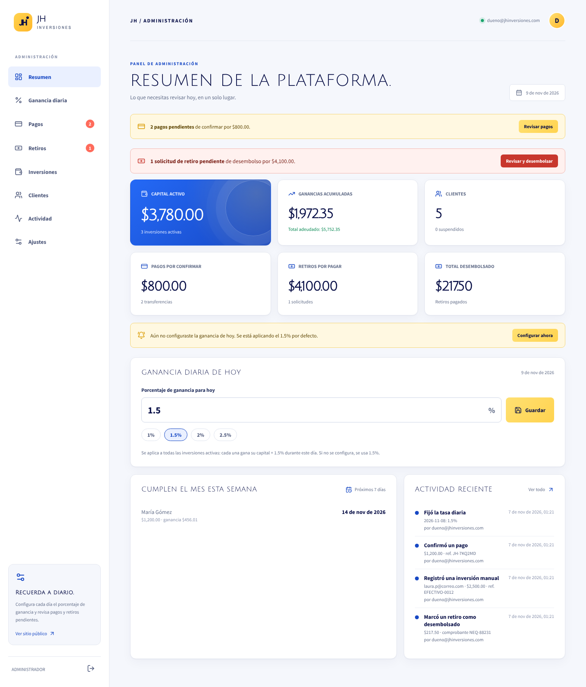
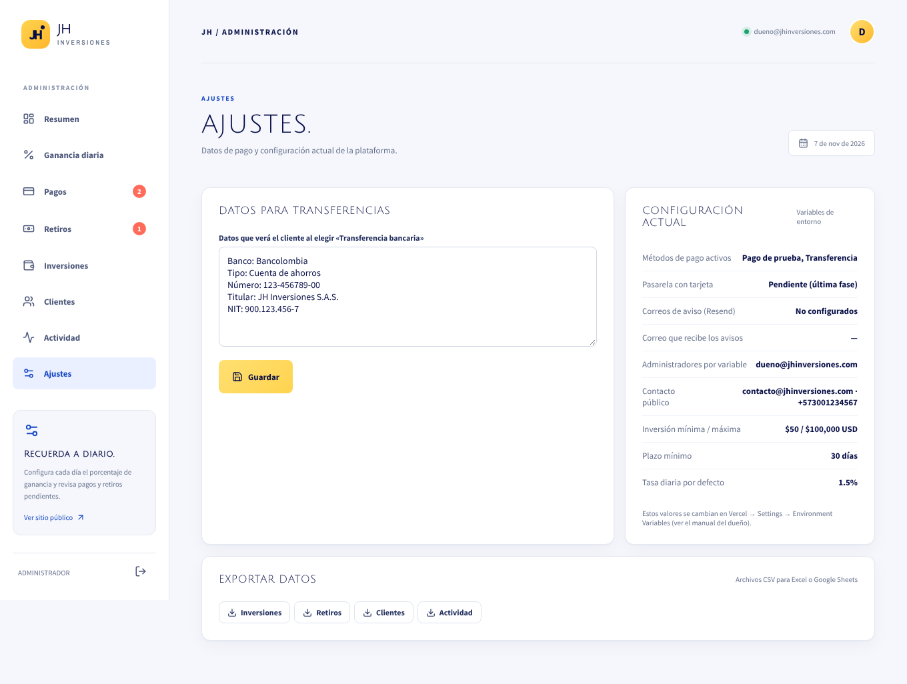
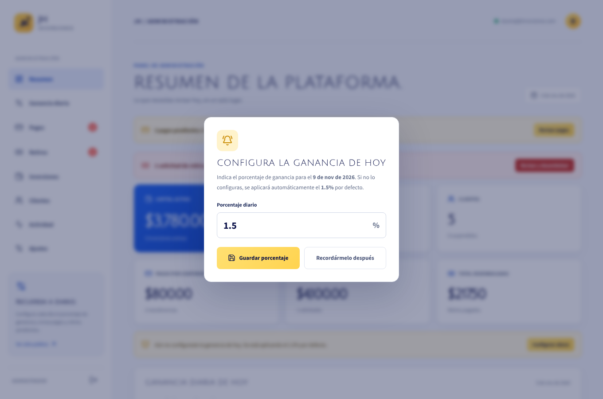
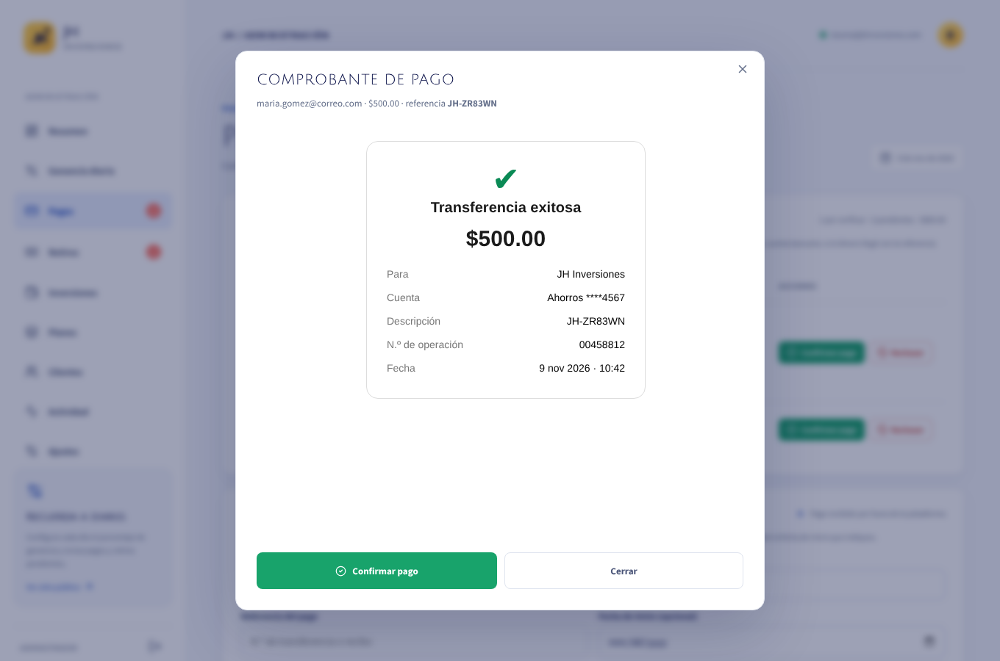
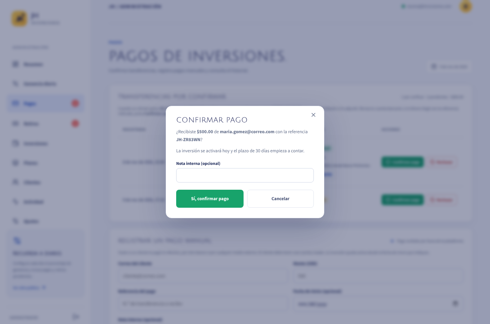
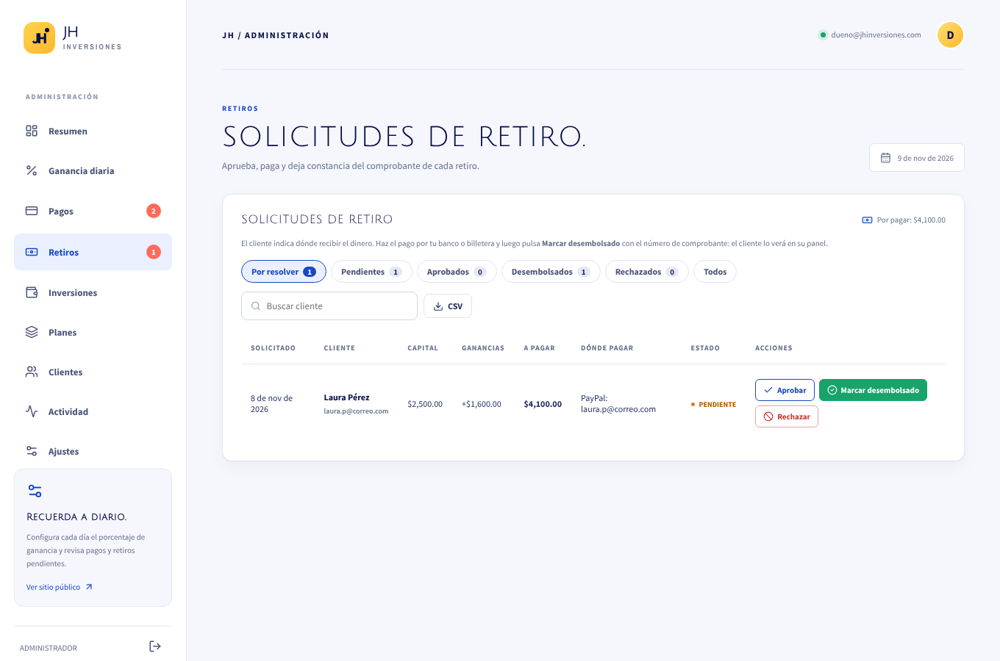
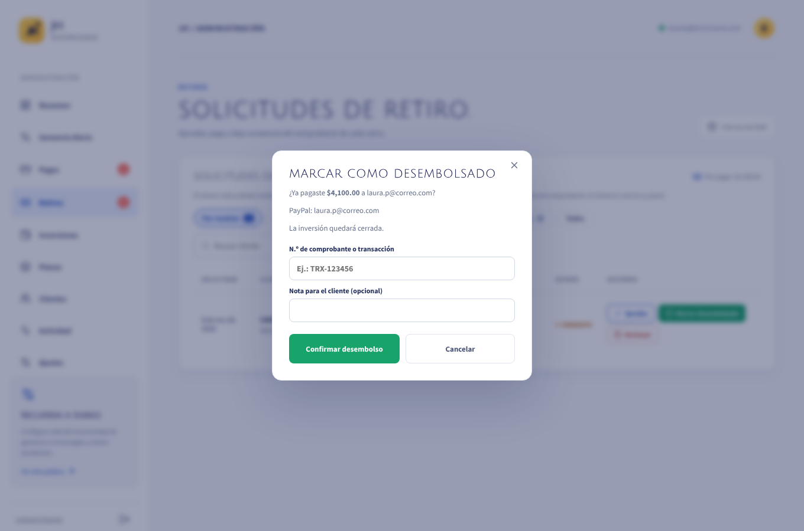

# Guía del administrador · JH Inversiones

Una guía corta y sencilla: cómo entrar a tu panel y qué hacer cada día, paso a paso.

> Las imágenes de esta guía usan datos de ejemplo (clientes y montos ficticios).

---

## 1. Cómo entrar al panel

**Necesitas tres datos:**

| Qué | Dato |
|---|---|
| Dirección de la página | **https://jh-inversiones-six.vercel.app** |
| Tu correo | El correo de administrador que te registraron |
| Tu contraseña | La que creaste la primera vez (paso 2) |

**Pasos:**

1. Abre la dirección de la página en tu navegador (Chrome, Safari, etc.), en la computadora o en el celular.
2. Pulsa **Iniciar sesión** (arriba a la derecha).
3. Escribe tu **correo** y tu **contraseña**.
4. Pulsa el botón **Iniciar sesión**.

¡Listo! La plataforma reconoce sola que eres administrador y te lleva a tu panel. **No tienes que elegir nada más.**

> Consejo: guarda la página en tus favoritos (o en la pantalla de inicio del celular) para entrar más rápido.

---

## 2. La primera vez (crear tu contraseña)

Si nunca has entrado, primero crea tu cuenta **con tu correo de administrador**:

1. En la pantalla de inicio de sesión, pulsa **¿No tienes cuenta? Regístrate**.
2. Escribe tu nombre, **tu correo de administrador** y una contraseña nueva.
3. Revisa tu correo: te llega un mensaje **«Confirma tu cuenta»**. Ábrelo y pulsa el enlace.
4. Vuelve a la página y entra con tu correo y tu contraseña (paso 1).

> Si el correo de confirmación no aparece, revisa la carpeta de **spam** o **correo no deseado**.

**¿Olvidaste tu contraseña?** En la pantalla de inicio de sesión pulsa **¿Olvidaste tu contraseña?**, escribe tu correo y sigue el enlace que te llega para crear una nueva.

**Para salir:** pulsa el icono de salida, abajo en el menú de la izquierda.

---

## 3. Conoce tu panel

A la izquierda está el **menú**. En el celular se abre con el botón **☰** (arriba a la derecha).

| Menú | Para qué sirve |
|---|---|
| **Resumen** | La página de inicio: lo que tienes pendiente hoy y las cifras principales |
| **Ganancia diaria** | Fijar el porcentaje que ganan los clientes cada día |
| **Pagos** | Confirmar las transferencias que te hicieron los clientes |
| **Retiros** | Pagar a los clientes que piden su dinero |
| **Inversiones** | Ver todas las inversiones |
| **Planes** | Los planes que se muestran en la página |
| **Clientes** | Ver y administrar a los clientes |
| **Actividad** | Todo lo que se ha hecho en el panel |
| **Ajustes** | Tus datos bancarios y descargar reportes |

Cuando hay algo pendiente, aparece un **número rojo** junto a *Pagos* o *Retiros*. Además, **te llega un correo** cuando un cliente avisa que te pagó o pide un retiro.

---

## 4. Antes de empezar (solo una vez)

Configura tus **datos de pago**, que son los que verán los clientes para transferirte:

1. En el menú, entra a **Ajustes**.
2. En **Foto con los datos de pago**, pulsa **Subir foto** y elige una imagen: por ejemplo, el QR de tu banco o una captura con los datos de tu cuenta.
3. En el cuadro de texto escribe tus datos: **banco, tipo y número de cuenta, nombre del titular y cédula o RUC**.
4. Pulsa **Guardar**.

Puedes cambiar la foto o el texto cuando quieras.

---

## 5. Lo que haces cada día

Solo son **3 tareas**:

| ✔ | Tarea | Dónde |
|---|---|---|
| 1 | Fijar la ganancia del día | **Ganancia diaria** (o la ventana que aparece al entrar) |
| 2 | Confirmar los pagos que te avisaron | **Pagos** |
| 3 | Pagar los retiros pendientes | **Retiros** |

En las páginas siguientes te explicamos cada una.

---

## 6. Tarea 1: fijar la ganancia del día

Al entrar, si aún no fijaste la ganancia de hoy, aparece esta ventana:

1. Escribe el porcentaje. Por ejemplo `1.5` (o pulsa uno de los botones rápidos).
2. Pulsa **Guardar porcentaje**.

**Bueno saber:**

- Si un día **no lo fijas**, se aplica **1.5 %** automáticamente.
- Si te equivocaste, ve a **Ganancia diaria**, busca el día en el historial y pulsa el lápiz ✏️ para corregirlo.

---

## 7. Tarea 2: confirmar un pago

**Así paga un cliente:**

1. El cliente elige cuánto invertir y ve **tus datos de pago** y un **código de referencia** (por ejemplo `JH-7KQ2MD`).
2. Te hace la transferencia y pulsa **«Ya realicé la transferencia»**, con la foto del comprobante si la tiene.
3. **Te llega un correo** «Transferencia por verificar» con el cliente, el monto y el comprobante.

**Lo que haces tú:**

1. Entra a **Pagos**. El pago aparece como **AVISÓ QUE PAGÓ**.
2. Pulsa **Ver comprobante** para ver la foto que envió el cliente.

3. **Revisa tu banco** y comprueba que llegó el dinero con ese monto.
4. Si llegó, pulsa **Confirmar pago** y luego **Sí, confirmar pago**.

Listo: la inversión del cliente queda **activa** desde ese día y él recibe un correo.

**¿El dinero no llegó o llegó otro monto?** Pulsa **Rechazar** y escribe el motivo (por ejemplo «no se recibió la transferencia»). El cliente verá el motivo.

> ⚠️ **Confirma un pago solo cuando veas el dinero en tu cuenta.**

---

## 8. Tarea 3: pagar un retiro

Cuando una inversión cumple **30 días**, el cliente puede pedir su dinero. Te llega un correo y aparece en **Retiros**.

**Pasos:**

1. Entra a **Retiros**. Mira dos columnas:
   - **A pagar:** cuánto le debes (su inversión + sus ganancias).
   - **Dónde pagar:** su banco o cuenta.
2. **Haz el pago** desde tu banco por ese monto.
3. Vuelve al panel y pulsa **Marcar desembolsado**.
4. Escribe el **número de comprobante** de tu pago y pulsa **Confirmar desembolso**.

El cliente recibe un correo con el comprobante.

**¿Los datos del cliente están mal o incompletos?** Pulsa **Rechazar** y explica el motivo: el cliente corrige sus datos y lo vuelve a pedir.

> ⚠️ Marca **«desembolsado» solo después de pagar**. Si un retiro dice **«Pago de prueba: no ingresó dinero»**, no lo pagues: recházalo.

---

## 9. Otras cosas que puedes hacer

**Un cliente te pagó en efectivo o por fuera de la página**
1. Pídele que cree su cuenta en la página.
2. Ve a **Pagos → Registrar un pago manual**.
3. Escribe su correo, el monto y el número de recibo, y pulsa **Registrar inversión**.

**Suspender a un cliente** (si sospechas de algo)
Ve a **Clientes**, pulsa su nombre y luego **Suspender**. No podrá invertir ni retirar hasta que lo reactives.

**Que otra persona te ayude a administrar**
Pídele que cree su cuenta. Luego ve a **Clientes**, pulsa su nombre y elige **Hacer administrador**.

**Descargar reportes para tu contabilidad**
Ve a **Ajustes → Exportar datos**. Los archivos se abren con Excel o Google Sheets.

---

## 10. Preguntas rápidas

**No puedo entrar.**
Revisa que el correo esté bien escrito. Si no recuerdas la contraseña, usa **¿Olvidaste tu contraseña?**

**Entro y veo el panel de cliente, no el de administrador.**
Estás usando un correo que no es el de administrador. Sal y entra con el correo correcto, o pide a tu soporte técnico que agregue ese correo como administrador.

**No me llegan los correos de aviso.**
Revisa la carpeta de spam. Igual puedes ver todo lo pendiente en **Pagos** y **Retiros** (números rojos).

**Olvidé fijar la ganancia de un día.**
Ese día se aplicó 1.5 %. Puedes corregirlo en **Ganancia diaria** con el lápiz ✏️.

**Un cliente no recibe su correo de confirmación.**
Que revise su carpeta de spam y que confirme que escribió bien su correo.

---

## 11. Reglas de oro

1. Fija la ganancia **todos los días**.
2. Confirma un pago **solo cuando veas el dinero** en tu banco.
3. Marca un retiro como pagado **solo después de pagarlo**, y siempre con el comprobante.
4. **No compartas tu contraseña.** Si alguien te ayuda, crea una cuenta de administrador para esa persona.
5. Descarga los reportes **cada mes** como respaldo.
