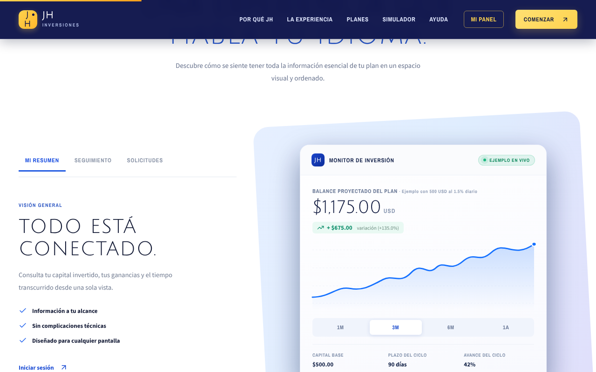
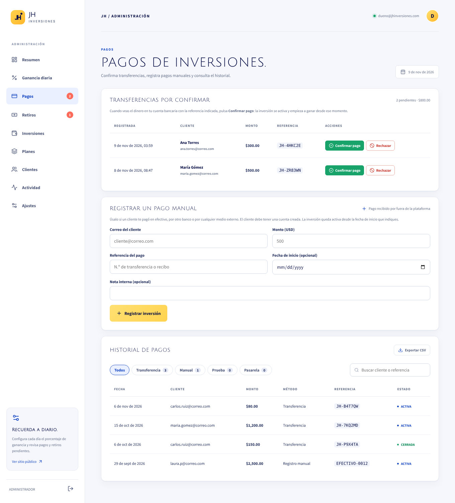

# Guía del administrador · JH Inversiones

Una guía corta y sencilla: cómo entrar a tu panel y qué hacer cada día, paso a paso.

> Las imágenes de esta guía usan datos de ejemplo (clientes y montos ficticios).

---

## 1. Cómo entrar al panel

**Necesitas tres datos:**

| Qué | Dato |
|---|---|
| Dirección de la página | **https://jh-inversiones-six.vercel.app** |
| Tu correo | El correo de administrador que te registraron |
| Tu contraseña | La que creaste la primera vez (paso 2) |

**Pasos:**

1. Abre la dirección de la página en tu navegador (Chrome, Safari, etc.), en la computadora o en el celular.
2. Pulsa **Iniciar sesión** (arriba a la derecha).
3. Escribe tu **correo** y tu **contraseña**.
4. Pulsa el botón **Iniciar sesión**.

¡Listo! La plataforma reconoce sola que eres administrador y te lleva a tu panel. **No tienes que elegir nada más.**

> Consejo: guarda la página en tus favoritos (o en la pantalla de inicio del celular) para entrar más rápido.

### Entrar rápido: la sesión queda guardada

No tienes que escribir tu contraseña cada vez. Después de entrar una vez, **el navegador recuerda tu sesión** (en ese mismo navegador y dispositivo):

- El **encabezado de la página queda fijo arriba**, aunque bajes por la página.
- Con la sesión abierta, el encabezado muestra el botón **MI PANEL** en lugar de *Iniciar sesión*. Un clic y estás en tu panel de administración.
- Si abres la pantalla de inicio de sesión con la sesión abierta, te lleva directo a tu panel.

La sesión solo se cierra si pulsas **Cerrar sesión** (icono de salida, abajo en el menú) o si pasas más de un año sin entrar.

> ⚠️ En una computadora compartida o prestada, **cierra sesión siempre** al terminar.

---

## 2. La primera vez (crear tu contraseña)

Si nunca has entrado, primero crea tu cuenta **con tu correo de administrador**:

1. En la pantalla de inicio de sesión, pulsa **¿No tienes cuenta? Regístrate**.
2. Escribe **tu correo de administrador** y una contraseña nueva (mínimo 8 caracteres).
3. Pulsa **Crear cuenta**. Entrarás directo a tu panel de administrador.
4. Si la página te pide **confirmar tu correo**, abre el mensaje **«Confirma tu cuenta»** que te llegó, pulsa el enlace y luego entra con tu correo y tu contraseña (paso 1).

> Si un correo de la plataforma no aparece, revisa la carpeta de **spam** o **correo no deseado**.

**¿Olvidaste tu contraseña?** En la pantalla de inicio de sesión pulsa **¿Olvidaste tu contraseña?**, escribe tu correo y sigue el enlace que te llega para crear una nueva.

**Para salir:** pulsa el icono de salida, abajo en el menú de la izquierda. En el celular, abre el menú ☰ y pulsa **Cerrar sesión**.

---

## 3. Conoce tu panel

A la izquierda está el **menú**. En el celular se abre con el botón **☰** (arriba a la derecha).

| Menú | Para qué sirve |
|---|---|
| **Resumen** | La página de inicio: lo que tienes pendiente hoy y las cifras principales |
| **Ganancia diaria** | Fijar el porcentaje que ganan los clientes cada día |
| **Pagos** | Confirmar las transferencias que te hicieron los clientes |
| **Retiros** | Pagar a los clientes que piden su dinero |
| **Inversiones** | Ver todas las inversiones |
| **Planes** | Los planes que se muestran en la página |
| **Clientes** | Ver y administrar a los clientes |
| **Actividad** | Todo lo que se ha hecho en el panel |
| **Ajustes** | Tus datos bancarios y descargar reportes |

Cuando hay algo pendiente, aparece un **número rojo** junto a *Pagos* o *Retiros*. Además, **te llega un correo** cuando un cliente avisa que te pagó o pide un retiro.

---

## 4. Antes de empezar (solo una vez)

Configura tus **datos de pago**, que son los que verán los clientes para transferirte:

1. En el menú, entra a **Ajustes**.
2. En **Foto con los datos de pago**, pulsa **Subir foto** y elige una imagen: por ejemplo, el QR de tu banco o una captura con los datos de tu cuenta.
3. En el cuadro de texto escribe tus datos: **banco, tipo y número de cuenta, nombre del titular y cédula o RUC**.
4. Pulsa **Guardar**.

Puedes cambiar la foto o el texto cuando quieras.

---

## 5. Lo que haces cada día

Solo son **3 tareas**:

| ✔ | Tarea | Dónde |
|---|---|---|
| 1 | Fijar la ganancia del día | **Ganancia diaria** (o la ventana que aparece al entrar) |
| 2 | Confirmar los pagos que te avisaron | **Pagos** |
| 3 | Pagar los retiros pendientes | **Retiros** |

En las páginas siguientes te explicamos cada una.

---

## 6. Tarea 1: fijar la ganancia del día

Al entrar, si aún no fijaste la ganancia de hoy, aparece esta ventana:

1. Escribe el porcentaje. Por ejemplo `1.5` (o pulsa uno de los botones rápidos).
2. Pulsa **Guardar porcentaje**.

**Bueno saber:**

- Si un día **no lo fijas**, se aplica **1.5 %** automáticamente.
- Si te equivocaste, ve a **Ganancia diaria**, busca el día en el historial y pulsa el lápiz ✏️ para corregirlo.

---

## 7. Tarea 2: confirmar un pago

**Así paga un cliente:**

1. El cliente elige cuánto invertir y ve **tus datos de pago** y un **código de referencia** (por ejemplo `JH-7KQ2MD`).
2. Te hace la transferencia y pulsa **«Ya realicé la transferencia»**, con la foto del comprobante si la tiene.
3. **Te llega un correo** «Transferencia por verificar» con el cliente, el monto y el comprobante.

**Lo que haces tú:**

1. Entra a **Pagos**. Los pagos avisados salen **primero** en la lista, marcados como **AVISÓ QUE PAGÓ**, con la fecha del aviso y el número de operación que escribió el cliente. Los que todavía no avisan dicen **AÚN NO AVISA**.

2. Pulsa **Ver comprobante** para ver la foto que envió el cliente.

3. **Revisa tu banco** y comprueba que llegó el dinero con ese monto.
4. Si llegó, pulsa **Confirmar pago** y luego **Sí, confirmar pago**.

Listo: la inversión del cliente queda **activa** desde ese día y él recibe un correo.

**¿El dinero no llegó o llegó otro monto?** Pulsa **Rechazar** y escribe el motivo (por ejemplo «no se recibió la transferencia»). El cliente verá el motivo.

> ⚠️ **Confirma un pago solo cuando veas el dinero en tu cuenta.**

### ¿Dónde veo el comprobante que subió el cliente?

En **dos lugares**:

| Dónde | Qué ves |
|---|---|
| **Panel → Pagos** | El botón **Ver comprobante** en la fila del pago. Abre la foto en grande y desde ahí mismo puedes pulsar **Confirmar pago**. |
| **Tu correo** | El aviso **«Transferencia por verificar»** trae la foto **adjunta**, junto con el cliente, el monto y la referencia. |

**Bueno saber:**

- Subir la foto es **opcional** para el cliente. Si no la sube, el aviso te llega igual pero **sin** el botón *Ver comprobante*: verifica el pago en tu banco con la **referencia** (`JH-…`) y el **monto**.
- Si el cliente cerró la página antes de avisar, puede hacerlo después desde su panel: el pago pendiente tiene el mismo botón **«Ya realicé la transferencia»**.
- Mientras esperas, el cliente ve su pago como **EN VERIFICACIÓN**.
- El comprobante **solo lo ve un administrador**. Ningún otro cliente puede verlo.

---

## 8. Tarea 3: pagar un retiro

Cuando una inversión cumple **30 días**, el cliente puede pedir su dinero. Te llega un correo y aparece en **Retiros**.

**Pasos:**

1. Entra a **Retiros**. Mira dos columnas:
   - **A pagar:** cuánto le debes (su inversión + sus ganancias).
   - **Dónde pagar:** su banco o cuenta.
2. **Haz el pago** desde tu banco por ese monto.
3. Vuelve al panel y pulsa **Marcar desembolsado**.
4. Escribe el **número de comprobante** de tu pago y pulsa **Confirmar desembolso**.

El cliente recibe un correo con el comprobante.

**¿Los datos del cliente están mal o incompletos?** Pulsa **Rechazar** y explica el motivo: el cliente corrige sus datos y lo vuelve a pedir.

> ⚠️ Marca **«desembolsado» solo después de pagar**. Si un retiro dice **«Pago de prueba: no ingresó dinero»**, no lo pagues: recházalo.

---

## 9. Los correos de la plataforma

La plataforma envía correos automáticos en español, siempre desde la misma dirección (servicio **Resend**). No tienes que hacer nada para que salgan.

**Correos que te llegan a ti (administrador):**

| Cuándo | Asunto del correo |
|---|---|
| Un cliente avisa que ya transfirió | «Transferencia por verificar: $…» (con el comprobante adjunto, si lo subió) |
| Un cliente pide un retiro | «Solicitud de retiro por $…» (con sus datos para pagarle) |

**Correos que le llegan al cliente:**

| Cuándo | Asunto del correo |
|---|---|
| Crea su cuenta | «Bienvenido» |
| Pide cambiar su contraseña | «Restablece tu contraseña» (con un enlace que sirve una vez y vence en 1 hora) |
| Confirmas o rechazas su pago | «Pago confirmado» / «Pago no confirmado» (con el motivo) |
| Registras un pago manual | «Inversión registrada» |
| Apruebas, pagas o rechazas su retiro | «Retiro aprobado» / «Retiro desembolsado» (con el comprobante) / «Retiro rechazado» (con el motivo) |

**¿Cómo sé si los correos están funcionando?** En **Ajustes**, *Correos de aviso* debe decir **Activos**.

> ⚠️ **Importante:** mientras la plataforma use la dirección de prueba de Resend, los correos **solo llegan al correo dueño de la cuenta de Resend**. Los clientes no los reciben hasta que tu soporte técnico conecte el dominio propio (por ejemplo `avisos@jhinversiones.com`). La plataforma funciona igual: todo lo pendiente lo ves en el panel.

---

## 10. Otras cosas que puedes hacer

**Un cliente te pagó en efectivo o por fuera de la página**
1. Pídele que cree su cuenta en la página.
2. Ve a **Pagos → Registrar un pago manual**.
3. Escribe su correo, el monto y el número de recibo, y pulsa **Registrar inversión**.

**Suspender a un cliente** (si sospechas de algo)
Ve a **Clientes**, pulsa su nombre y luego **Suspender**. No podrá invertir ni retirar hasta que lo reactives.

**Que otra persona te ayude a administrar**
Pídele que cree su cuenta. Luego ve a **Clientes**, pulsa su nombre y elige **Hacer administrador**. Para quitarle el acceso: mismo lugar, **Quitar administrador**.

**Una cuenta de administrador de prueba (para enseñar la plataforma)**
1. Cierra sesión y crea una cuenta nueva con **¿No tienes cuenta? Regístrate** (por ejemplo `demo@…`).
2. Vuelve a entrar con **tu** cuenta de administrador, ve a **Clientes**, abre la cuenta nueva y pulsa **Hacer administrador**.
3. Ya puedes entrar con la cuenta de prueba y mostrar el panel.
4. Al terminar la demostración, pulsa **Quitar administrador** en esa cuenta.

> ⚠️ Una cuenta de prueba trabaja sobre los **datos reales**: no confirmes pagos ni cambies la ganancia del día durante una demostración, a menos que sea a propósito.

**Descargar reportes para tu contabilidad**
Ve a **Ajustes → Exportar datos**. Los archivos se abren con Excel o Google Sheets.

---

## 11. Preguntas rápidas

**¿Tengo que escribir mi contraseña cada vez?**
No. La sesión queda guardada en tu navegador: pulsa **MI PANEL** en el encabezado. Solo vuelves a escribirla si cerraste sesión o entras desde otro dispositivo.

**¿El administrador ve el comprobante que sube el cliente?**
Sí: en **Pagos → Ver comprobante** y adjunto en el correo «Transferencia por verificar» (sección 7).

**No puedo entrar.**
Revisa que el correo esté bien escrito. Si no recuerdas la contraseña, usa **¿Olvidaste tu contraseña?**

**Entro y veo el panel de cliente, no el de administrador.**
Estás usando un correo que no es el de administrador. Sal y entra con el correo correcto, o pide a tu soporte técnico que agregue ese correo como administrador.

**No me llegan los correos de aviso.**
Revisa la carpeta de spam y que en **Ajustes** diga *Correos de aviso: Activos*. Igual puedes ver todo lo pendiente en **Pagos** y **Retiros** (números rojos). Mira también el aviso de la sección 9.

**Olvidé fijar la ganancia de un día.**
Ese día se aplicó 1.5 %. Puedes corregirlo en **Ganancia diaria** con el lápiz ✏️.

**Un cliente no recibe los correos de la plataforma.**
Que revise su carpeta de spam y que confirme que escribió bien su correo. Si la plataforma todavía usa la dirección de prueba de Resend, a los clientes no les llegan (sección 9).

---

## 12. Reglas de oro

1. Fija la ganancia **todos los días**.
2. Confirma un pago **solo cuando veas el dinero** en tu banco.
3. Marca un retiro como pagado **solo después de pagarlo**, y siempre con el comprobante.
4. **No compartas tu contraseña.** Si alguien te ayuda, crea una cuenta de administrador para esa persona.
5. Descarga los reportes **cada mes** como respaldo.
