# Manual de uso · JH Inversiones

Cómo administrar la plataforma día a día: qué revisar cada día y cómo usar cada sección del panel de administración.

> Las imágenes de este manual usan datos de ejemplo (clientes y montos ficticios).

---

## 1. Cómo funciona la plataforma

| Regla | Valor |
|---|---|
| Moneda | Dólares estadounidenses (USD) en todo: inversiones, ganancias y retiros |
| Inversión mínima | **50 USD** (máximo 100,000 USD por inversión) |
| Plazo mínimo | **30 días** antes de poder solicitar el retiro |
| Ganancia | Un porcentaje **diario** que tú fijas cada día. Si un día no lo fijas, se aplica **1.5 %** |
| Retiro | Capital + ganancias acumuladas. Tú revisas la solicitud y haces el pago |

**El recorrido de un cliente:**

1. Se **registra** con su correo y lo confirma desde el enlace que recibe.
2. Elige un **monto** (desde el mínimo, 50 USD al empezar) y un **método de pago**.
3. Cuando el pago queda confirmado, su inversión pasa a **activa** y suma ganancias cada día.
4. Cada día tú **fijas el porcentaje** de ganancia (o se aplica 1.5 %).
5. Al cumplir **30 días** puede **solicitar el retiro** e indicar dónde quiere recibir el dinero.
6. Tú **haces el pago** por tu banco o billetera y lo **marcas como desembolsado** con el número de comprobante.

**Planes** (se asignan solos según el monto; tú los puedes cambiar en **Planes**, sección 10):

| Plan | Desde |
|---|---|
| Impulso | 50 USD |
| Órbita | 500 USD |
| Horizonte | 2,000 USD |

Estos son los planes con los que arranca la plataforma.

---

## 2. Primeros pasos

Antes de recibir a tus primeros clientes:

1. **Entra al panel** con tu correo de administrador (sección 3).
2. Ve a **Ajustes**, sube una **foto con tus datos de pago** (por ejemplo, el QR de tu banco) y escribe los **datos de tu cuenta bancaria**. Es lo que verán los clientes que paguen por transferencia (sección 12).
3. **Fija la ganancia del día** en la ventana que aparece al entrar (sección 5).
4. Si quieres, haz una inversión de prueba con otra cuenta para ver el recorrido completo como cliente.

---

## 3. Entrar al panel

1. Ve a la página de la plataforma y pulsa **Iniciar sesión**.
2. Escribe tu correo y tu contraseña y pulsa **Iniciar sesión**. No hay que elegir nada más: la plataforma reconoce que tu cuenta es de administrador y te lleva directo al panel de administración. Los clientes, con la misma pantalla, entran a su propio panel.

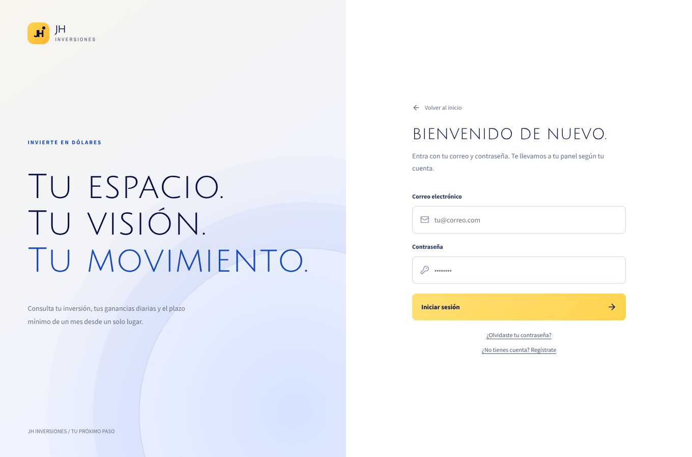

**La primera vez:** pulsa **¿No tienes cuenta? Regístrate** con tu correo de administrador y crea tu contraseña. Entrarás directo al panel de administración.

- **¿Olvidaste tu contraseña?** Te llega un enlace por correo para crear una nueva.
- **Cerrar sesión:** icono de salida, abajo en el menú lateral.
- **Desde el celular:** el menú se abre con el botón ☰ arriba a la derecha.

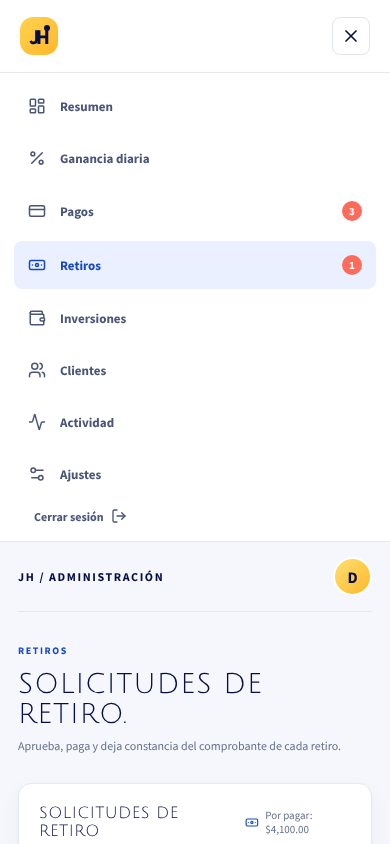

---

## 4. Tu rutina diaria

| Cuándo | Qué hacer | Dónde |
|---|---|---|
| Cada día | Fijar el porcentaje de ganancia del día | **Ganancia diaria** (o la ventana que aparece al entrar) |
| Cada día | Verificar las transferencias que los clientes avisaron y confirmarlas | **Pagos → Transferencias por confirmar** |
| Cada día | Revisar y pagar los retiros pendientes | **Retiros → Por resolver** |
| Cada semana | Ver qué inversiones cumplen el mes, para tener el dinero listo | **Resumen → Cumplen el mes esta semana** |
| Cada mes | Descargar los reportes para tu contabilidad | **Ajustes → Exportar datos** |

El menú lateral muestra **números rojos** en *Pagos* y *Retiros* cuando hay algo pendiente. El panel se actualiza solo cada 30 segundos. Además, te llega un **correo** cada vez que un cliente avisa que ya hizo su transferencia (con la foto del comprobante adjunta, si la subió) o solicita un retiro.

---

## 5. Ganancia diaria

Cada día fijas el **porcentaje de ganancia** que reciben todas las inversiones activas.

Al entrar al panel, si aún no fijaste el de hoy, aparece esta ventana:

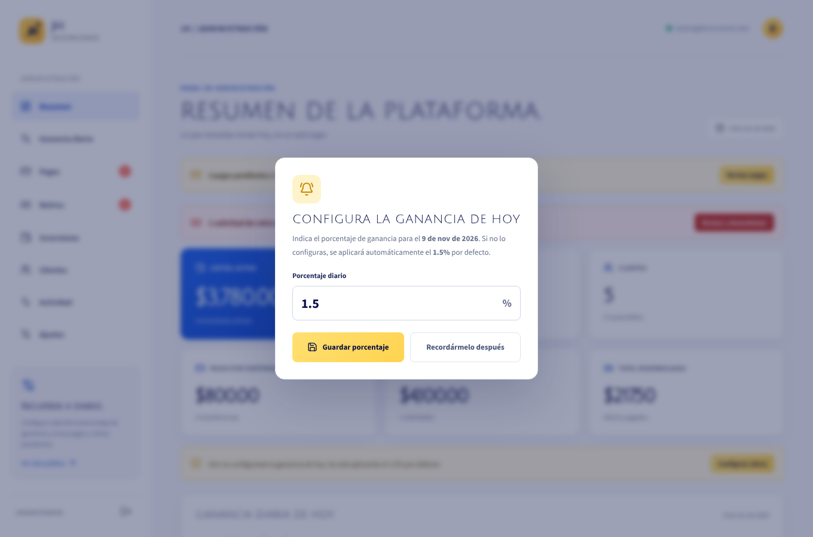

- Escribe el porcentaje (por ejemplo `1.5`) y pulsa **Guardar porcentaje**.
- **Recordármelo después** cierra la ventana, pero queda un aviso amarillo hasta que lo fijes.
- Si no lo fijas, ese día se aplica **1.5 %** automáticamente.

En la sección **Ganancia diaria** tienes el **historial de 60 días**. Con el lápiz ✏️ puedes **corregir un día anterior**; las ganancias de todos los clientes se recalculan al instante.

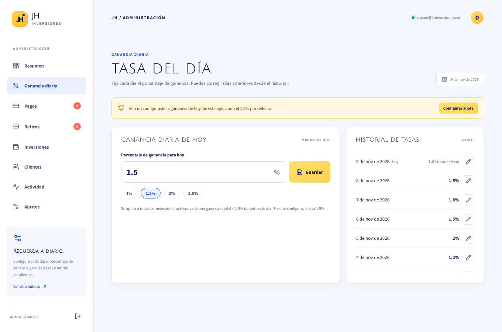

> Los botones 1 %, 1.5 %, 2 % y 2.5 % son atajos. Se acepta cualquier valor entre 0 y 100. No se puede fijar un día futuro.

---

## 6. Resumen

Es la página de inicio del panel. Reúne lo que debes revisar hoy.

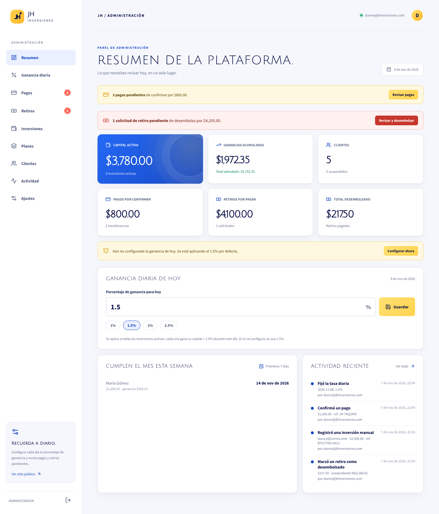

- **Avisos de colores:** pagos por confirmar (amarillo) y retiros por pagar (rojo), con un botón para ir directo.
- **Cifras clave:**
  - *Capital activo:* dinero invertido en inversiones activas.
  - *Ganancias acumuladas:* lo que han ganado esas inversiones. *Total adeudado* = capital + ganancias.
  - *Clientes:* cuentas registradas (y cuántas están suspendidas).
  - *Pagos por confirmar:* transferencias registradas que aún no confirmaste.
  - *Retiros por pagar:* suma de las solicitudes de retiro abiertas.
  - *Total desembolsado:* todo lo que ya pagaste en retiros.
- **Ganancia diaria de hoy:** para fijar la tasa sin cambiar de página.
- **Cumplen el mes esta semana:** inversiones que podrán pedir retiro en los próximos 7 días.
- **Actividad reciente:** las últimas acciones hechas en el panel.

---

## 7. Pagos

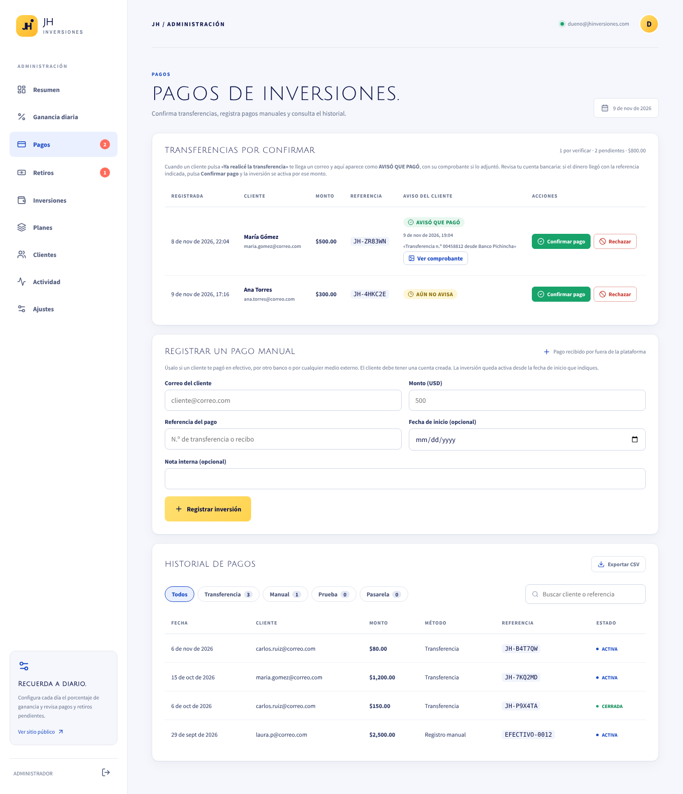

### Transferencias por confirmar

Así funciona el pago por transferencia:

1. El cliente elige el monto y **Transferencia bancaria**. La plataforma le muestra tu **foto con los datos de pago**, tus datos bancarios y un **código de referencia** (por ejemplo `JH-7KQ2MD`) que debe escribir en la descripción de su transferencia. La inversión queda en **Pago pendiente** y no gana nada todavía.
2. El cliente hace la transferencia y pulsa **«Ya realicé la transferencia»**. Puede añadir el n.º de operación y una **foto del comprobante**.
3. **Te llega un correo** «Transferencia por verificar» con el cliente, el monto, la referencia y el comprobante adjunto. En *Pagos* esa fila aparece como **AVISÓ QUE PAGÓ** (las que aún no avisan dicen *AÚN NO AVISA*).
4. Pulsa **Ver comprobante** para ver la foto que envió el cliente.

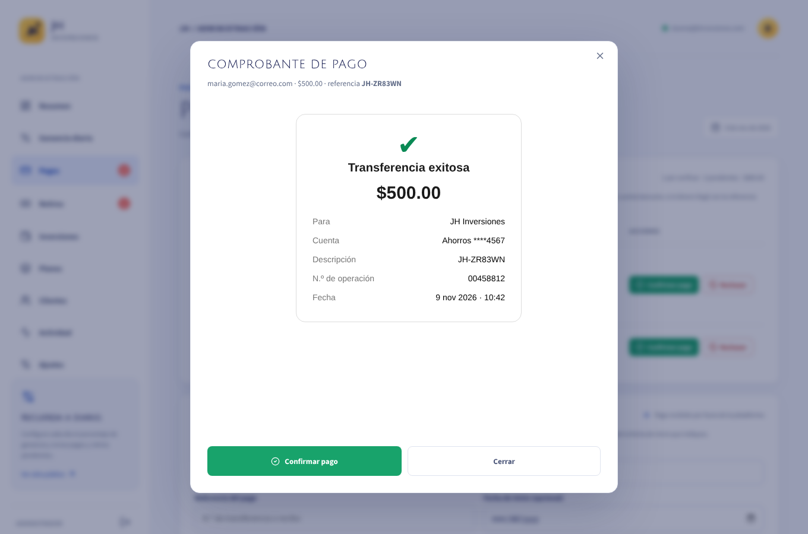

5. Revisa tu banco y busca la transferencia con ese código y ese monto. Si llegó, pulsa **Confirmar pago** → **Sí, confirmar pago**.

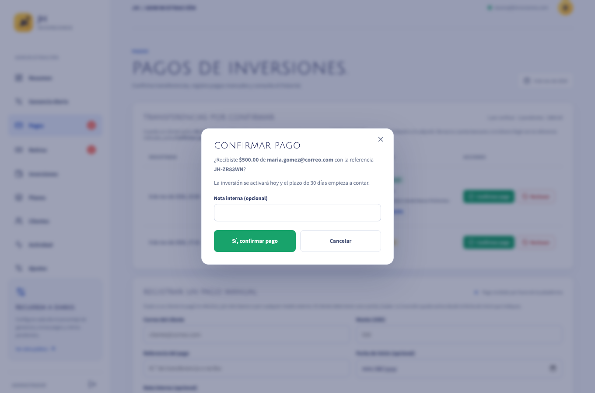

Al confirmar, la inversión se activa **ese mismo día**: el plazo de 30 días y las ganancias empiezan a contar desde ahí, y el cliente recibe un correo.

**Si el dinero no llegó** (o llegó otro monto): pulsa **Rechazar** y escribe el motivo. La inversión queda **cancelada**; el cliente ve el motivo y puede registrar una nueva.

### Registrar un pago manual

Úsalo cuando un cliente te pagó **por fuera de la plataforma** (efectivo, otro banco, otra billetera):

1. El cliente debe tener una cuenta creada.
2. Escribe su **correo**, el **monto**, la **referencia del pago** (n.º de transferencia o de recibo) y, si quieres, la **fecha de inicio** (por defecto, hoy) y una nota interna.
3. Pulsa **Registrar inversión**. Queda **activa** de inmediato y el cliente recibe un correo.

La plataforma no permite repetir una referencia: así evitas registrar dos veces el mismo pago.

### Historial de pagos

La lista de todos los pagos, con filtros por método (transferencia, manual, prueba) y búsqueda por cliente o referencia. **Exportar CSV** la descarga para Excel.

---

## 8. Retiros

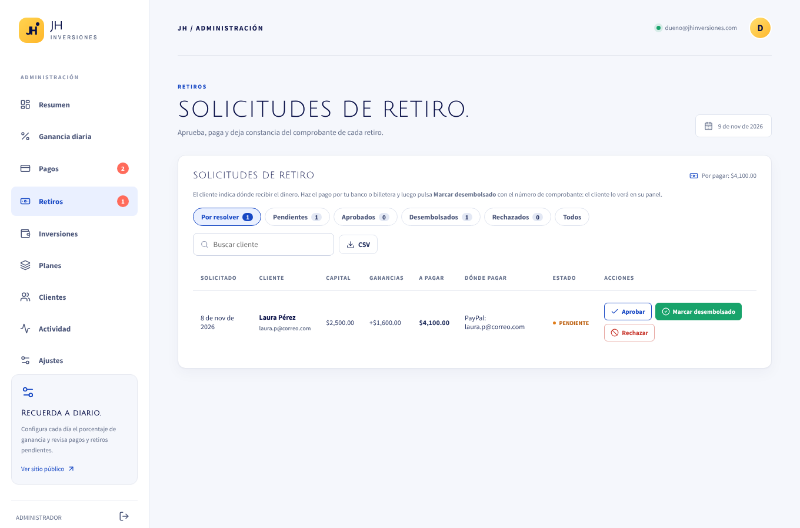

Cuando una inversión cumple 30 días, el cliente puede pulsar **Solicitar retiro** e indicar **dónde quiere recibir el dinero** (banco y cuenta, Nequi, PayPal…). En ese momento:

- Sus **ganancias se congelan**: el monto a pagar queda fijo.
- Te llega el aviso en el panel (número rojo en *Retiros*) y por correo.

Las columnas clave son *A pagar* (capital + ganancias) y *Dónde pagar* (los datos que escribió el cliente).

| Botón | Para qué | Qué ve el cliente |
|---|---|---|
| **Aprobar** (opcional) | Avisar que el retiro procede y que el pago está en proceso | «Aprobado: el desembolso está en proceso» |
| **Marcar desembolsado** | **Después** de pagarle, dejar constancia con el n.º de comprobante | «Desembolsado» + el comprobante |
| **Rechazar** | Si algo no cuadra (datos incompletos, etc.). El motivo es obligatorio | «Rechazado» + el motivo; puede volver a pedirlo y sus ganancias vuelven a sumar |

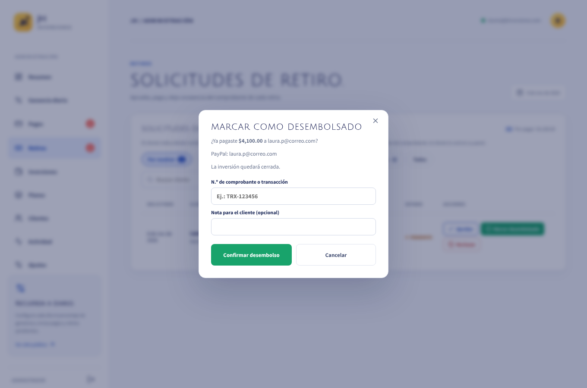

**Paso a paso para pagar un retiro:**

1. Copia los datos de *Dónde pagar*.
2. Haz el pago desde tu banco o billetera por el monto de *A pagar*.
3. Vuelve al panel → **Marcar desembolsado** → escribe el n.º de comprobante → **Confirmar desembolso**.
4. La inversión queda **cerrada** y el cliente recibe un correo con el comprobante.

> ⚠️ Si una solicitud muestra **«Pago de prueba: no ingresó dinero»**, esa inversión se creó con el pago de prueba y nunca entró dinero real. No la pagues: recházala.

Las pestañas de arriba filtran por estado: *Por resolver*, *Pendientes*, *Aprobados*, *Desembolsados*, *Rechazados* y *Todos*.

---

## 9. Inversiones

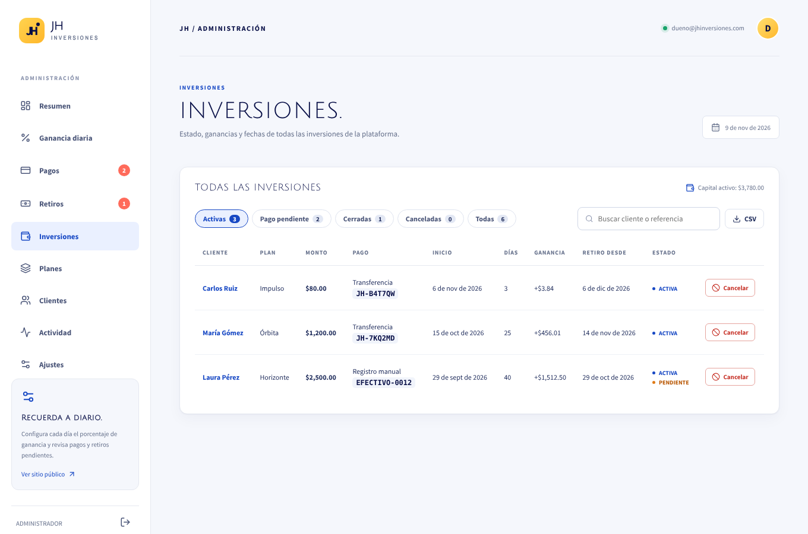

Todas las inversiones, con filtros por estado (*Activas*, *Pago pendiente*, *Cerradas*, *Canceladas*), búsqueda y exportación. De cada una ves el plan, el monto, el método y la referencia de pago, los días transcurridos, la ganancia y la fecha desde la que se puede retirar.

**Cancelar una inversión:** solo para devoluciones o errores. Pide un motivo y deja la inversión **sin ganancias**; el cliente ya no podrá retirarla. Si tiene un retiro en curso, primero resuélvelo en *Retiros*.

> Si el cliente simplemente quiere su dinero después del mes, no canceles: usa el flujo normal de **Retiros**.

---

## 10. Planes

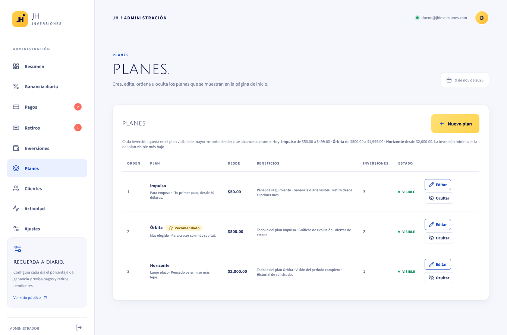

Aquí decides **qué planes ves y ofreces** en la página de inicio. Los cambios se publican al instante.

- La tabla muestra cada plan con su **orden**, su **monto desde**, sus beneficios, cuántas **inversiones** tiene y si está **visible** u **oculto**.
- Arriba se resume cómo se reparten hoy los montos: por ejemplo *Impulso de $50 a $499 · Órbita de $500 a $1,999 · Horizonte desde $2,000*.

**Cómo se asigna el plan:** cada inversión queda en el plan visible de mayor «monto desde» que alcance su monto. No hay que hacer nada: el cliente escribe su monto y el plan aparece solo.

**La inversión mínima** de la plataforma es el «monto desde» del plan visible más bajo. Si subes el de *Impulso* a 100, desde ese momento nadie podrá invertir menos de 100 USD, y la página de inicio lo dirá así. Nunca puede ser menor de 50 USD.

### Crear o editar un plan

Pulsa **Nuevo plan** (o **Editar** en un plan). Se abre el formulario debajo de la lista:

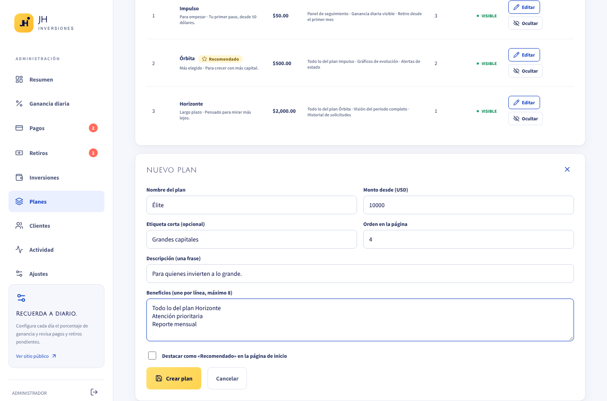

Completa los campos:

| Campo | Para qué sirve |
|---|---|
| Nombre del plan | Lo que ven los clientes (ej.: *Élite*) |
| Monto desde (USD) | Desde cuánto aplica el plan. Entre 50 y 100,000 USD; no puede repetirse entre planes visibles |
| Etiqueta corta | Texto pequeño sobre el nombre (ej.: *Para grandes capitales*) |
| Orden en la página | 1, 2, 3… el orden de izquierda a derecha en la página de inicio |
| Descripción | Una frase debajo del nombre |
| Beneficios | Uno por línea (hasta 8). Aparecen con una ✓ |
| Destacar como «Recomendado» | Resalta la tarjeta en la página de inicio |

Pulsa **Crear plan** o **Guardar cambios**.

> Cambiar un plan no modifica las inversiones que ya existen: conservan su monto, sus fechas y sus ganancias. Si cambias el nombre, el nuevo nombre se ve también en esas inversiones.

### Ocultar o eliminar

- **Ocultar:** el plan deja de mostrarse y de asignarse a inversiones nuevas. Las inversiones que ya tiene siguen igual. **Mostrar** lo vuelve a publicar.
- **Eliminar:** solo aparece en planes **sin inversiones** (por ejemplo, uno que creaste por error). Los planes con inversiones solo se pueden ocultar.
- Siempre debe quedar **al menos un plan visible**.

> La ganancia diaria y el plazo mínimo de 30 días son **iguales para todos los planes**: la ganancia la fijas cada día en *Ganancia diaria*.

---

## 11. Clientes

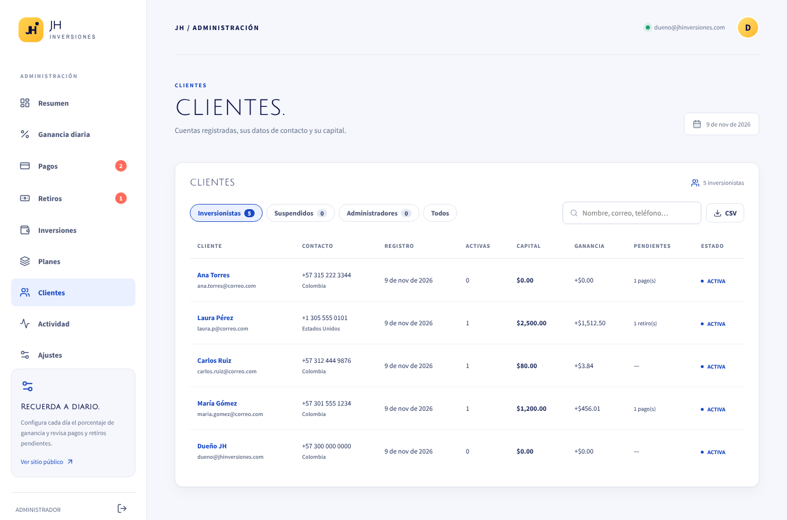

Las cuentas registradas, con su contacto, fecha de registro, capital activo, ganancia y lo que tienen pendiente. Las pestañas filtran por *Inversionistas*, *Suspendidos* y *Administradores*. Pulsa un nombre para abrir la **ficha del cliente**:

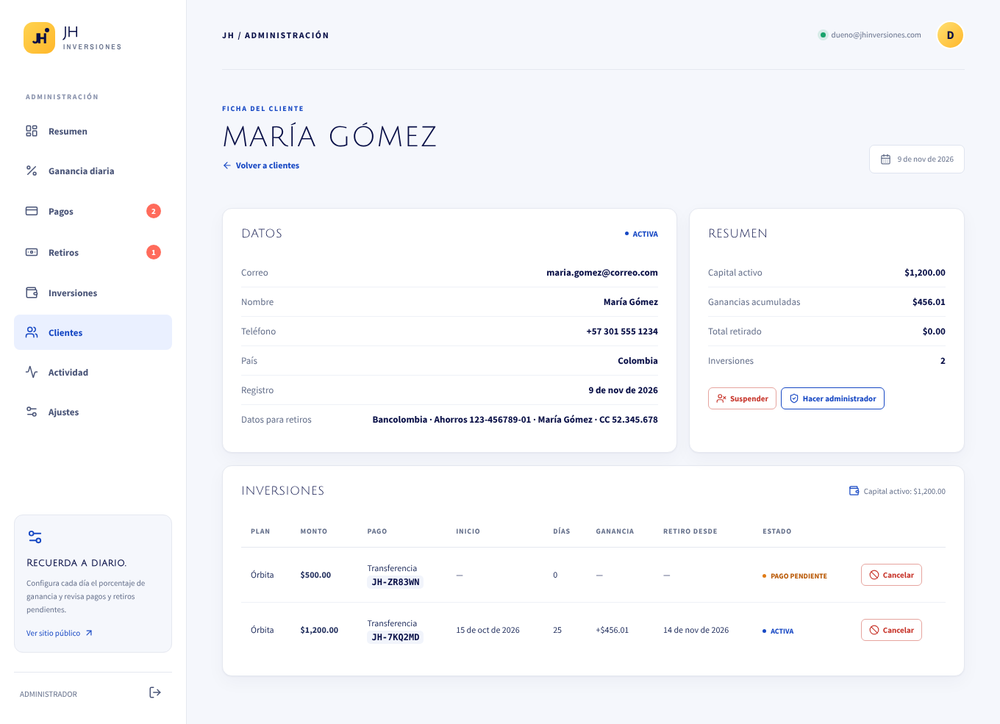

La ficha muestra sus **datos** (también dónde quiere recibir sus retiros), un **resumen** de su dinero y todas sus inversiones. Acciones:

- **Suspender:** puede entrar y ver su panel, pero **no puede invertir ni pedir retiros**. Úsalo ante sospechas o problemas con la cuenta. **Reactivar** lo revierte.
- **Hacer administrador / Quitar administrador:** da o quita el acceso completo a este panel. Úsalo para que otra persona de tu equipo te ayude a administrar.

No puedes suspenderte ni quitarte el rol a ti mismo.

---

## 12. Ajustes y exportaciones

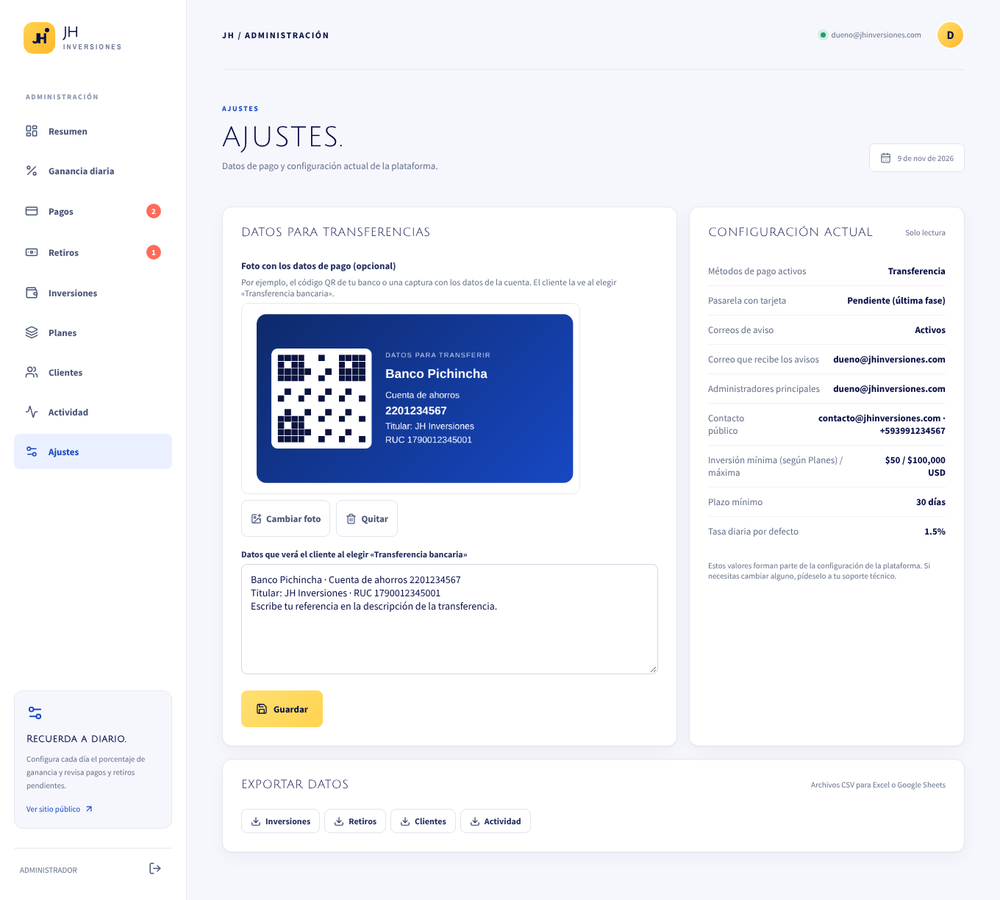

- **Datos para transferencias:** lo que ve el cliente al elegir *Transferencia bancaria*:
  - **Foto con los datos de pago:** pulsa **Subir foto** y elige una imagen (el QR de tu banco o una captura con los datos de la cuenta). Puedes cambiarla o quitarla cuando quieras.
  - **Texto:** banco, tipo y número de cuenta, titular, RUC o documento…

  Pulsa **Guardar** para que los clientes vean los cambios.
- **Configuración actual:** información de consulta (métodos de pago activos, correos de aviso, reglas de inversión). Si necesitas cambiar algo de esta lista, pídeselo a tu soporte técnico.
- **Exportar datos:** descarga archivos de **inversiones, retiros, clientes y actividad**, que se abren con Excel o Google Sheets.

---

## 13. Actividad

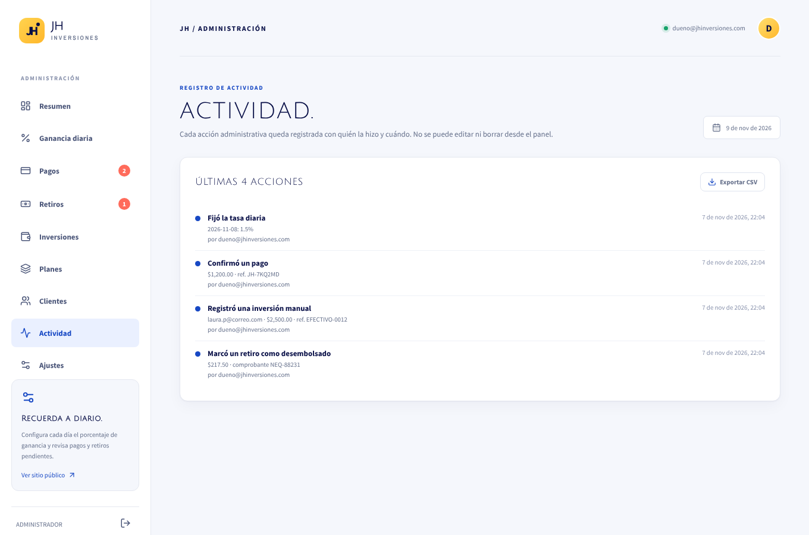

Registra **todas las acciones** hechas en el panel: quién las hizo, cuándo y con qué datos. Por ejemplo: tasas fijadas, pagos confirmados o rechazados, inversiones manuales o canceladas, retiros aprobados, pagados o rechazados, cuentas suspendidas, cambios de planes y cambios de rol o de ajustes. **No se puede editar ni borrar**, así que te sirve de respaldo y de auditoría.

---

## 14. Lo que ve el cliente

Conocer su recorrido te ayuda a darle soporte.

**Su panel:** capital, ganancias, ganancia de hoy, gráfico de 30 días, avance del plazo mínimo, pagos pendientes (con tus datos de pago, su referencia y el botón para avisar que ya transfirió), solicitudes de retiro y todas sus inversiones.

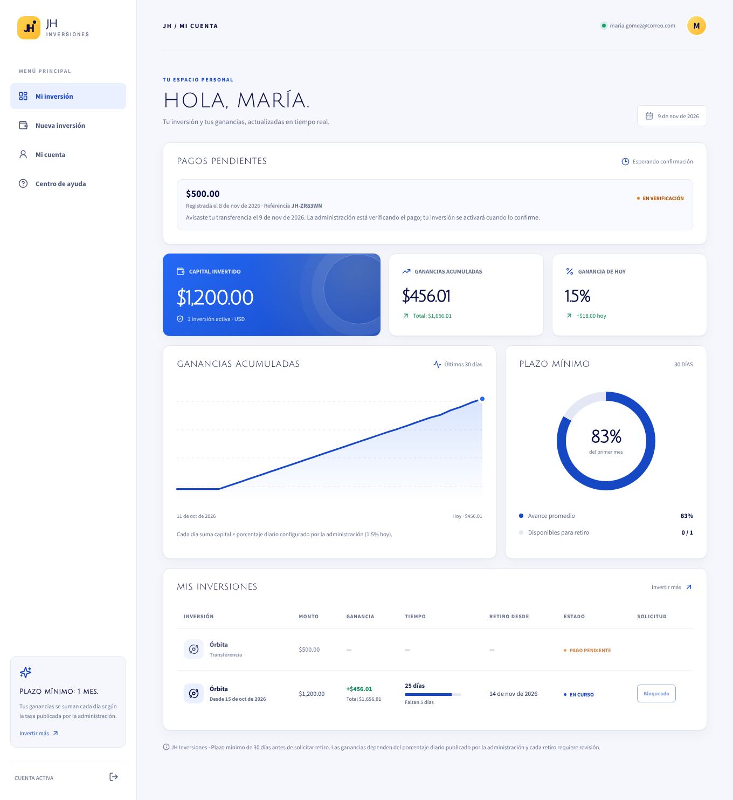

**Nueva inversión:** elige el monto y ve su plan, la ganancia de hoy y la fecha de retiro. Luego elige el método de pago y acepta los términos.

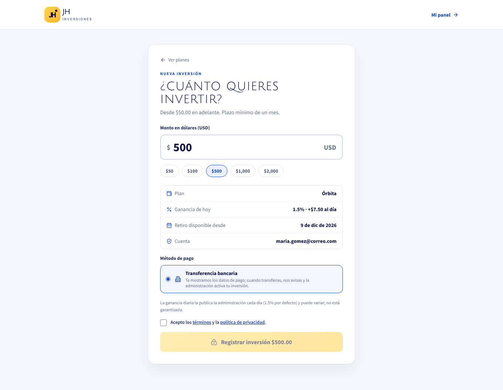

Si elige **transferencia**, ve tu foto con los datos de pago, tus datos bancarios y su **referencia**, con un botón para copiarla:

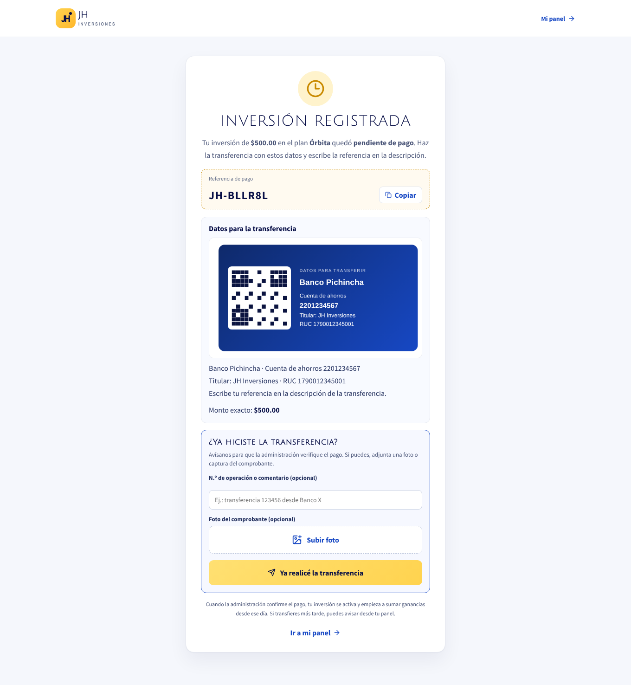

Cuando ya transfirió, escribe el n.º de operación, sube la foto del comprobante (opcional) y pulsa **Ya realicé la transferencia**:

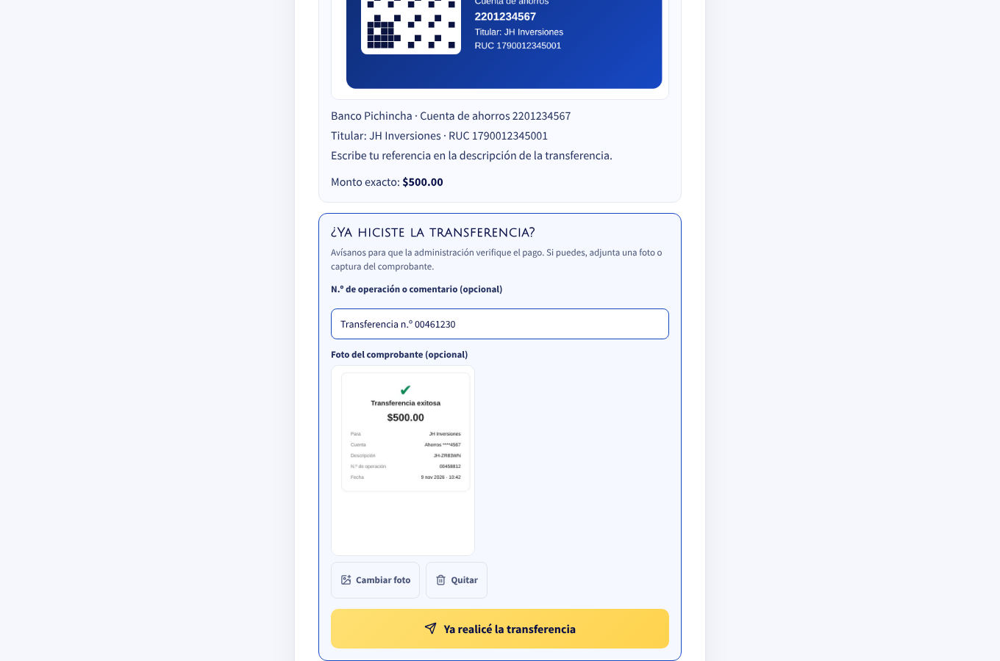

La plataforma le confirma que la administración fue avisada. En su panel, el pago pasa a **EN VERIFICACIÓN** hasta que lo confirmes. Si cierra la página antes de avisar, puede hacerlo después desde su panel.

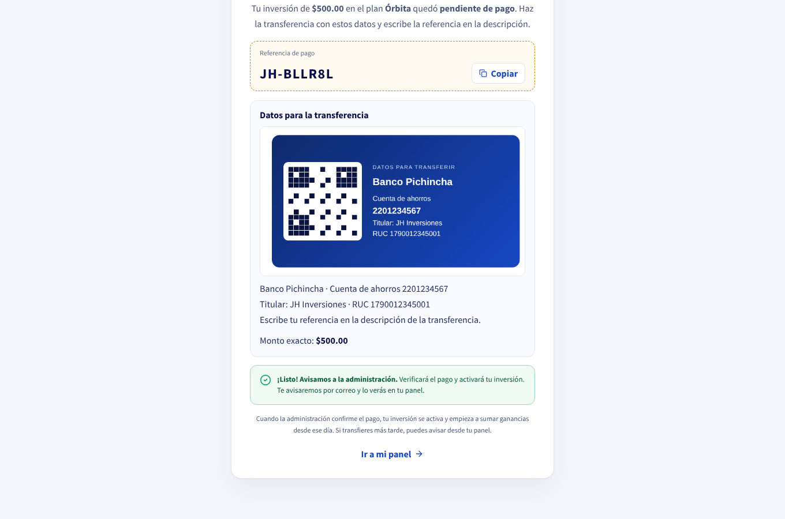

**Mi cuenta:** nombre, teléfono, país, **dónde recibir los retiros** y cambio de contraseña. Al pedir un retiro, sus datos de pago se rellenan solos desde aquí.

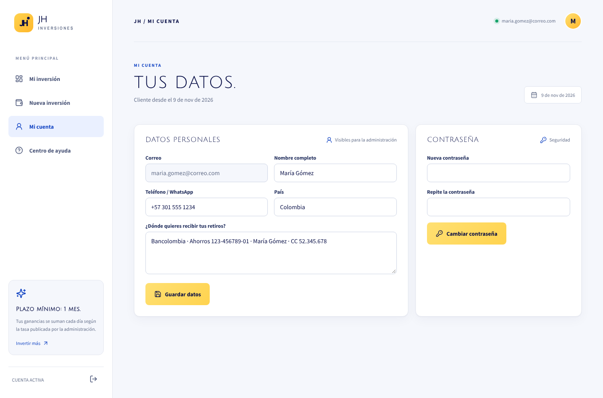

**Retiro solicitado:** el cliente ve el estado en todo momento.

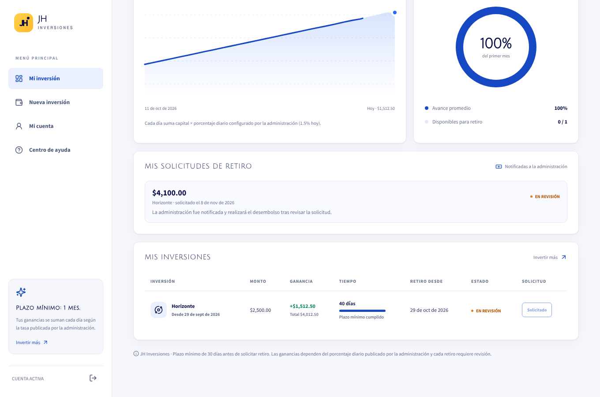

---

## 15. Cómo se calculan las ganancias

Cada día la inversión gana **capital × porcentaje de ese día** (interés simple: las ganancias de un día no generan ganancias al día siguiente).

**Ejemplo** con 1,000 USD:

| Día | Tasa del día | Ganancia del día | Acumulado |
|---|---|---|---|
| 1 | 1.5 % (por defecto) | 15.00 | 15.00 |
| 2 | 2 % | 20.00 | 35.00 |
| 3 | 1 % | 10.00 | 45.00 |

- El día en curso suma de forma **proporcional** a las horas transcurridas, por eso el cliente ve su saldo subir en tiempo real.
- Los días se cuentan en **hora de Colombia (Bogotá)**.
- Las ganancias empiezan cuando el pago queda **confirmado**, no cuando el cliente registra una transferencia.
- Al **solicitar el retiro**, las ganancias se **congelan**. Si rechazas la solicitud, vuelven a sumar.
- Si corriges la tasa de un día pasado, todas las ganancias se recalculan con el nuevo valor.

---

## 16. Estados y su significado

**Inversión**

| Estado | Significado |
|---|---|
| Pago pendiente | Registrada por transferencia; el cliente aún no avisa que pagó. No gana nada. |
| Pago pendiente · avisó que pagó (cliente: *En verificación*) | El cliente avisó su transferencia; revisa tu banco y confírmala o recházala. No gana nada todavía. |
| Activa | Pago confirmado; gana cada día. |
| Cerrada | Retiro desembolsado. |
| Cancelada | Pago rechazado o inversión anulada. No gana nada. |

**Retiro**

| Estado | Significado |
|---|---|
| Pendiente / En revisión | El cliente lo solicitó; debes revisarlo. |
| Aprobado | Lo aprobaste; falta hacer el pago. |
| Desembolsado | Ya pagaste y registraste el comprobante. |
| Rechazado | No procede; el cliente ve el motivo y puede volver a pedirlo. |

**Cuenta:** *Activa* o *Suspendida*.

---

## 17. Correos automáticos

| Cuándo | Quién lo recibe |
|---|---|
| Alguien se registra | El cliente: «Confirma tu cuenta» |
| Alguien pide cambiar su contraseña | El cliente: «Restablece tu contraseña» |
| Un cliente avisa que ya hizo su transferencia (con el comprobante adjunto si lo subió) | Tú |
| Un cliente solicita un retiro (con sus datos de pago) | Tú |
| Confirmas o rechazas un pago | El cliente |
| Registras una inversión manual | El cliente |
| Apruebas, desembolsas o rechazas un retiro | El cliente |

---

## 18. Métodos de pago

| Método | Cómo funciona |
|---|---|
| **Transferencia bancaria** | El cliente transfiere a tu cuenta con su referencia, avisa con **«Ya realicé la transferencia»** y tú confirmas el pago en *Pagos* |
| **Registro manual** | Tú registras un pago recibido por fuera de la plataforma |
| **Pago de prueba** | Se acepta al instante y muestra «Pago de prueba aceptado». **No cobra dinero**: sirve para probar la plataforma |
| **Tarjeta de crédito o débito** | Próxima fase: se habilitará cuando se conecte la pasarela de pagos |

> Cuando empieces a operar con dinero real, pide a tu soporte técnico que desactive el **pago de prueba**.

---

## 19. Preguntas frecuentes

**Olvidé fijar la tasa de un día.**
Ese día se aplicó 1.5 %. Si quieres otro valor, ve a *Ganancia diaria* → historial → ✏️ en ese día.

**Un cliente transfirió un monto distinto al registrado.**
Rechaza la inversión pendiente (motivo: «monto distinto») y registra un **pago manual** por el monto que realmente llegó, con la referencia de la transferencia.

**Un cliente me pagó en efectivo.**
Pídele que se registre y usa *Pagos → Registrar un pago manual*.

**Un cliente no recibe el correo de confirmación.**
Que revise la carpeta de spam o correo no deseado y que confirme que escribió bien su correo. Si sigue sin llegar, contacta a tu soporte técnico.

**Un cliente olvidó su contraseña.**
Que use **¿Olvidaste tu contraseña?** en la página de inicio de sesión.

**Quiero que otra persona me ayude a administrar.**
Que se registre como cliente; luego ve a *Clientes → su ficha → Hacer administrador*.

**Los datos bancarios de un retiro están incompletos.**
**Recházalo** con el motivo: el cliente corrige sus datos y lo vuelve a pedir.

**Pagué un retiro pero olvidé marcarlo.**
Márcalo como desembolsado cuando lo veas, con el comprobante.

**Sospecho de una cuenta.**
**Suspéndela** desde su ficha: no podrá invertir ni retirar mientras revisas.

**¿Puedo cambiar los planes o la inversión mínima?**
Sí, en **Planes** (sección 10): crea, edita, ordena u oculta planes. La inversión mínima es la del plan visible más bajo.

**¿Puedo cambiar el plazo de 30 días o la tasa por defecto de 1.5 %?**
Son reglas de la plataforma: pídeselo a tu soporte técnico.

---

## 20. Buenas prácticas

- Fija la tasa **todos los días** a la misma hora.
- Confirma un pago **solo** cuando veas el dinero en tu cuenta.
- Marca un retiro como **desembolsado solo después de pagar**, y siempre con el comprobante.
- No pagues retiros marcados como **«Pago de prueba»**.
- Usa una contraseña fuerte y **no compartas tu cuenta**: crea una cuenta de administrador para cada persona.
- Descarga los reportes de **Ajustes → Exportar datos** cada mes como respaldo.
