# Manual del dueño · JH Inversiones

Guía para operar la plataforma día a día: qué hace, cómo se configura una sola vez, qué revisar cada día y cómo usar cada sección del panel de administración.

> **Para quién es:** el dueño o administrador de la plataforma. No necesitas conocimientos técnicos para usar el panel. Las únicas partes técnicas (configuración inicial y pasarela de pagos) están marcadas y se hacen una sola vez.

---

## Índice

1. [Cómo funciona la plataforma](#1-cómo-funciona-la-plataforma)
2. [Puesta en marcha (una sola vez)](#2-puesta-en-marcha-una-sola-vez)
3. [Tu rutina diaria](#3-tu-rutina-diaria)
4. [Entrar al panel](#4-entrar-al-panel)
5. [Resumen](#5-resumen)
6. [Ganancia diaria](#6-ganancia-diaria)
7. [Pagos](#7-pagos)
8. [Retiros](#8-retiros)
9. [Inversiones](#9-inversiones)
10. [Clientes](#10-clientes)
11. [Actividad](#11-actividad)
12. [Ajustes y exportaciones](#12-ajustes-y-exportaciones)
13. [Lo que ve el cliente](#13-lo-que-ve-el-cliente)
14. [Cómo se calculan las ganancias](#14-cómo-se-calculan-las-ganancias)
15. [Estados y su significado](#15-estados-y-su-significado)
16. [Correos automáticos](#16-correos-automáticos)
17. [Métodos de pago y la fase pendiente (pasarela)](#17-métodos-de-pago-y-la-fase-pendiente-pasarela)
18. [Preguntas frecuentes y solución de problemas](#18-preguntas-frecuentes-y-solución-de-problemas)
19. [Seguridad y buenas prácticas](#19-seguridad-y-buenas-prácticas)
20. [Pruebas automáticas](#20-pruebas-automáticas)

---

## 1. Cómo funciona la plataforma

| Regla | Valor |
|---|---|
| Moneda | Dólares estadounidenses (USD) en todo: inversiones, ganancias y retiros |
| Inversión mínima | **50 USD** (máximo 100,000 USD por inversión) |
| Plazo mínimo | **30 días** antes de poder solicitar el retiro |
| Ganancia | Un porcentaje **diario** que tú fijas cada día. Si un día no lo fijas, se aplica **1.5 %** |
| Retiro | Capital + ganancias acumuladas. Tú revisas la solicitud y haces el pago |

**El recorrido completo:**

1. El cliente se **registra** con su correo y lo confirma.
2. Elige un **monto** (desde 50 USD) y un **método de pago**.
3. Cuando el pago queda confirmado, la inversión pasa a **activa** y empieza a sumar ganancias cada día.
4. Cada día tú **fijas el porcentaje** de ganancia (o se usa 1.5 %).
5. Al cumplir **30 días**, el cliente puede **solicitar el retiro** e indica dónde quiere recibir el dinero.
6. Tú recibes el aviso, **haces el pago** por tu banco o billetera y lo **marcas como desembolsado** con el número de comprobante.

**Planes** (se asignan solos según el monto):

| Plan | Desde |
|---|---|
| Impulso | 50 USD |
| Órbita | 500 USD |
| Horizonte | 2,000 USD |

---

## 2. Puesta en marcha (una sola vez)

> Esta sección es técnica. Si un desarrollador te ayuda con la instalación, entrégale esta parte. Se hace **una sola vez**.

### 2.1 Base de datos (Supabase)

1. Crea un proyecto en [supabase.com](https://supabase.com/dashboard).
2. Ve a **SQL Editor → New query**, pega todo el archivo `supabase/schema.sql` y pulsa **Run**.
   El archivo se puede volver a ejecutar cuando haya una versión nueva: no borra datos.
3. En **Authentication → URL Configuration**:
   - **Site URL:** `https://TU_DOMINIO`
   - **Redirect URLs:** `https://TU_DOMINIO/**`
4. En **Authentication → Email Templates**, reemplaza el contenido de estas dos plantillas por las que están en el repositorio:
   - **Confirm signup** → `supabase/templates/confirmation.html`
   - **Reset password** → `supabase/templates/recovery.html`

   Así los enlaces del correo funcionan aunque el cliente los abra en otro dispositivo, por ejemplo en el celular.
5. **Recomendado:** en *Authentication → Emails* configura un servidor SMTP propio (por ejemplo, el de Resend). El correo incluido de Supabase envía muy pocos mensajes por hora y no sirve para producción.

### 2.2 Variables de entorno (Vercel)

En **Vercel → tu proyecto → Settings → Environment Variables** agrega:

| Variable | Obligatoria | Qué poner |
|---|---|---|
| `NEXT_PUBLIC_SUPABASE_URL` | Sí | Supabase → Project Settings → API → *Project URL* |
| `NEXT_PUBLIC_SUPABASE_ANON_KEY` | Sí | Supabase → API → clave *anon / public* |
| `SUPABASE_SERVICE_ROLE_KEY` | Sí | Supabase → API → clave *service_role* (**secreta**) |
| `ADMIN_EMAILS` | Sí | Tu correo (y el de otros administradores), separados por comas |
| `NEXT_PUBLIC_SITE_URL` | Sí | Tu dominio, p. ej. `https://jhinversiones.com` |
| `NEXT_PUBLIC_PAYMENT_METHODS` | No | Métodos visibles al invertir. Por defecto `test,transfer`. En producción real: `transfer` (ver §17) |
| `NEXT_PUBLIC_CONTACT_EMAIL` | No | Correo de contacto público |
| `NEXT_PUBLIC_CONTACT_WHATSAPP` | No | WhatsApp con código de país, solo dígitos (p. ej. `573001234567`) |
| `RESEND_API_KEY` | No | Para enviar correos de aviso (ver §16) |
| `RESEND_FROM_EMAIL` | No | Remitente verificado en Resend, p. ej. `avisos@jhinversiones.com` |
| `ADMIN_NOTIFICATION_EMAIL` | No | Correo que recibe los avisos de pagos y retiros |
| `PAYMENTS_APPROVED`, `STRIPE_SECRET_KEY`, `STRIPE_WEBHOOK_SECRET` | No | Solo para la pasarela (fase pendiente, §17) |

Después de cambiar variables, vuelve a desplegar el proyecto (Vercel → Deployments → *Redeploy*).

### 2.3 Primer acceso y configuración

1. Entra a `https://TU_DOMINIO/acceso` y pulsa **¿No tienes cuenta? Regístrate** con el correo que pusiste en `ADMIN_EMAILS`.
2. Confirma el correo desde el enlace que te llega.
3. Inicia sesión: entrarás directo al **panel de administración**.
4. Ve a **Ajustes** y escribe los **datos de tu cuenta bancaria** para transferencias.
5. Fija la **ganancia del día** (te lo pedirá una ventana).

### 2.4 Lista de verificación antes de abrir al público

- [ ] El esquema SQL está ejecutado y las plantillas de correo están cambiadas.
- [ ] Las URLs de Supabase tienen tu dominio.
- [ ] Puedes registrarte, confirmar el correo, entrar y recuperar la contraseña.
- [ ] En Ajustes están los datos bancarios correctos.
- [ ] Hiciste una inversión de prueba por transferencia y la confirmaste en **Pagos**.
- [ ] Decidiste si mantener el **pago de prueba** (ver §17: en producción real se debe quitar).
- [ ] El contacto (correo/WhatsApp) aparece en el pie de página.
- [ ] Los términos y la política de privacidad fueron revisados por un abogado.

---

## 3. Tu rutina diaria

| Cuándo | Qué hacer | Dónde |
|---|---|---|
| Cada día | Fijar el porcentaje de ganancia del día | **Ganancia diaria** (o la ventana que aparece al entrar) |
| Cada día | Confirmar las transferencias recibidas | **Pagos → Transferencias por confirmar** |
| Cada día | Revisar y pagar los retiros pendientes | **Retiros → Por resolver** |
| Cada semana | Revisar qué inversiones cumplen el mes (para preparar liquidez) | **Resumen → Cumplen el mes esta semana** |
| Cada mes | Exportar los CSV para tu contabilidad | **Ajustes → Exportar datos** |

El menú lateral muestra **números rojos** en *Pagos* y *Retiros* cuando hay algo pendiente. El panel se actualiza solo cada 30 segundos.

---

## 4. Entrar al panel

Ve a `/acceso`, elige la pestaña **Administrador**, escribe tu correo y contraseña y pulsa **Iniciar sesión**.

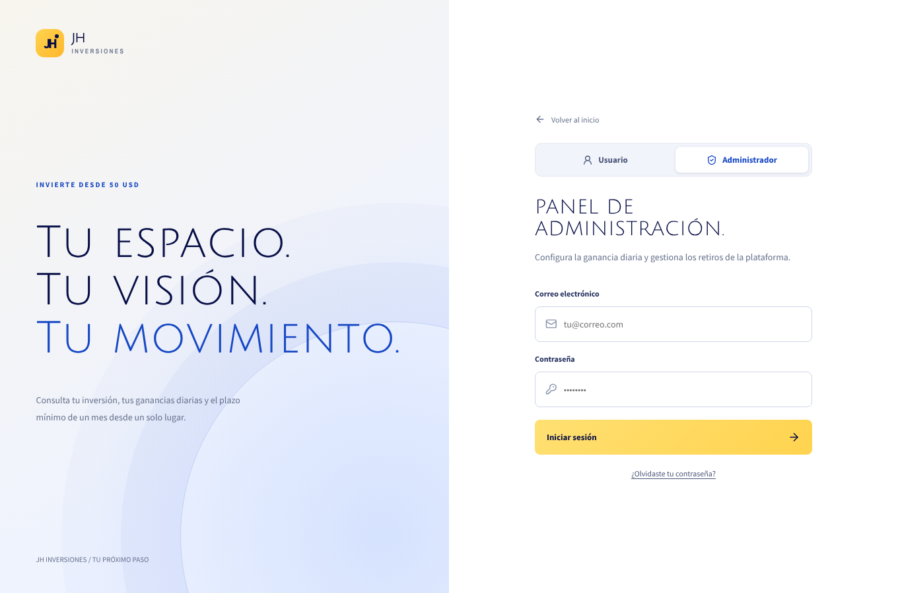

- Si olvidaste la contraseña: **¿Olvidaste tu contraseña?** → te llega un enlace por correo.
- Para salir: icono de salida abajo en el menú lateral (en el celular, en el menú ☰).

---

## 5. Resumen

Es la página de inicio del panel. Muestra lo que necesitas revisar hoy.

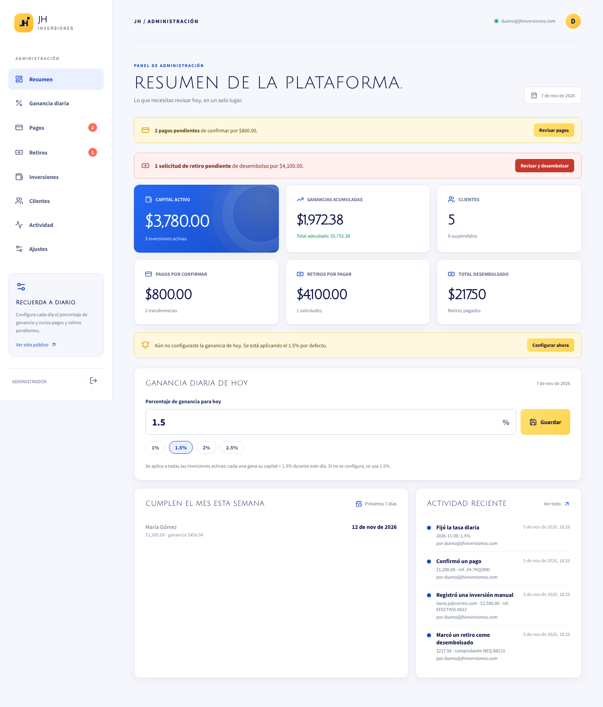

- **Avisos de colores** arriba: pagos por confirmar (amarillo) y retiros por pagar (rojo), con un botón para ir directo.
- **Cifras clave:**
  - *Capital activo:* dinero invertido en inversiones activas.
  - *Ganancias acumuladas:* lo que esas inversiones han ganado hasta ahora. *Total adeudado* = capital + ganancias.
  - *Clientes:* cuentas registradas (y cuántas están suspendidas).
  - *Pagos por confirmar:* transferencias registradas que aún no confirmaste.
  - *Retiros por pagar:* suma de las solicitudes de retiro abiertas.
  - *Total desembolsado:* todo lo que ya pagaste en retiros.
- **Ganancia diaria de hoy:** para fijar la tasa sin cambiar de página.
- **Cumplen el mes esta semana:** inversiones que podrán pedir retiro en los próximos 7 días. Úsalo para tener el dinero listo.
- **Actividad reciente:** las últimas acciones hechas en el panel.

---

## 6. Ganancia diaria

Cada día debes fijar el **porcentaje de ganancia** que reciben todas las inversiones activas.

Al entrar al panel, si aún no fijaste el de hoy, aparece esta ventana:

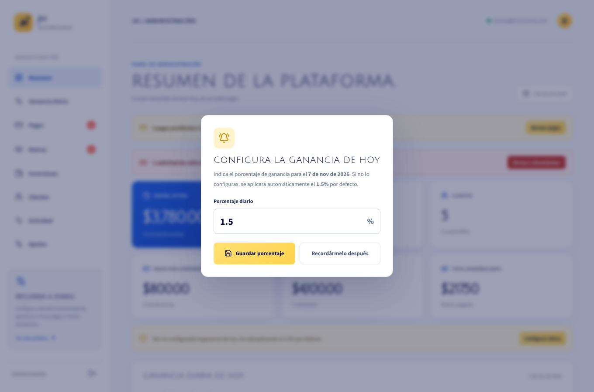

- Escribe el porcentaje (por ejemplo `1.5`) y pulsa **Guardar porcentaje**.
- **Recordármelo después** cierra la ventana, pero queda un aviso amarillo hasta que lo fijes.
- Si no lo fijas, ese día se aplica **1.5 %** automáticamente.

En **Ganancia diaria** también tienes el **historial de 60 días**. Con el lápiz ✏️ puedes **corregir un día anterior**. Las ganancias de todos los clientes se recalculan al instante.

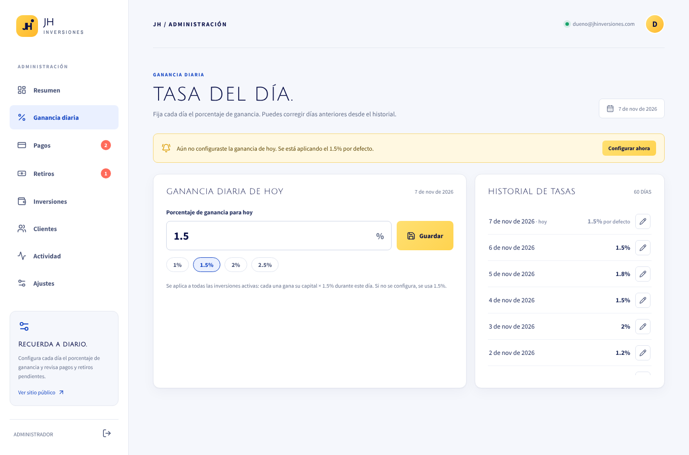

> Los botones 1 %, 1.5 %, 2 % y 2.5 % son atajos. Se acepta cualquier valor entre 0 y 100 con hasta 3 decimales. **No se puede fijar un día futuro.**

---

## 7. Pagos

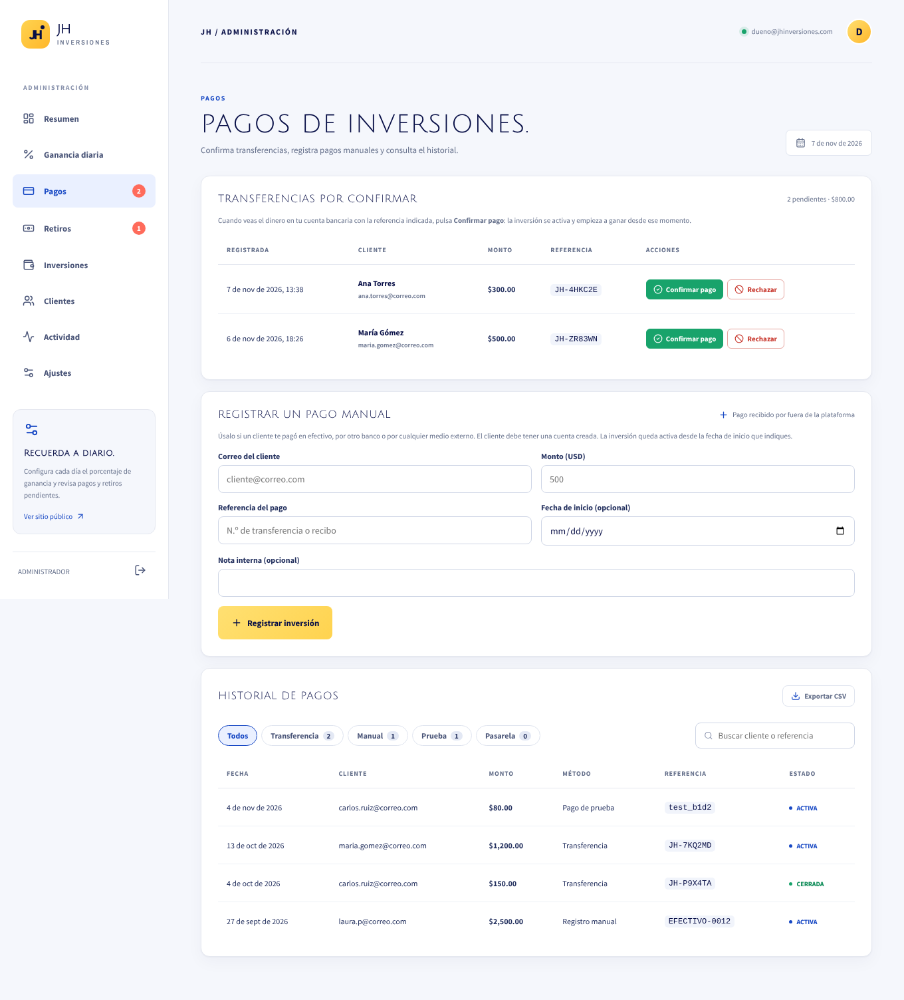

### 7.1 Transferencias por confirmar

Cuando un cliente elige **Transferencia bancaria**, la plataforma le muestra tus datos bancarios y un **código de referencia** (por ejemplo `JH-7KQ2MD`) para que lo escriba en la descripción de su transferencia. La inversión queda en **Pago pendiente** y no gana nada hasta que la confirmes.

1. Revisa tu banco y busca la transferencia con ese código y ese monto.
2. Pulsa **Confirmar pago** → **Sí, confirmar pago**.

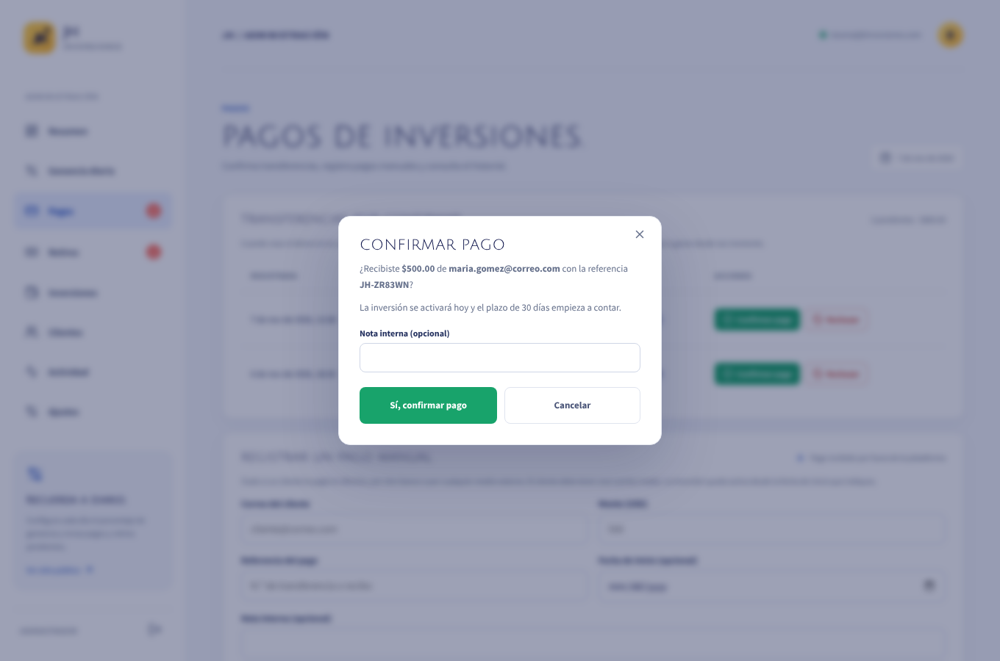

Al confirmar, la inversión se activa **ese mismo día**: el plazo de 30 días y las ganancias empiezan a contar desde ahí. Si Resend está configurado, el cliente recibe un correo.

**Si el dinero no llegó** (o llegó un monto distinto): pulsa **Rechazar**, escribe el motivo y la inversión queda **cancelada**. El cliente ve el motivo en su panel y puede registrar una nueva inversión.

### 7.2 Registrar un pago manual

Úsalo cuando un cliente te pagó **por fuera de la plataforma** (efectivo, otro banco, otra billetera):

1. El cliente debe tener una cuenta creada.
2. Escribe su **correo**, el **monto**, la **referencia del pago** (n.º de transferencia o de recibo) y, si quieres, la **fecha de inicio** (por defecto, hoy) y una nota interna.
3. Pulsa **Registrar inversión**. Queda **activa** de inmediato.

La plataforma no permite repetir una referencia, así evitas registrar dos veces el mismo pago.

### 7.3 Historial de pagos

La lista de todos los pagos, que puedes filtrar por método (transferencia, manual, prueba, pasarela) y buscar por cliente o referencia. Con **Exportar CSV** lo descargas para Excel.

---

## 8. Retiros

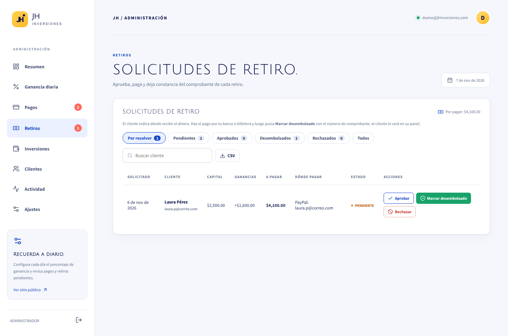

Cuando una inversión cumple 30 días, el cliente puede pulsar **Solicitar retiro** e indicar **dónde quiere recibir el dinero** (banco y cuenta, Nequi, PayPal…). En ese momento:

- Sus **ganancias se congelan**: el monto a pagar queda fijo.
- Recibes el aviso en el panel (número rojo en *Retiros*) y por correo si Resend está configurado.

**Columnas importantes:** *A pagar* (capital + ganancias) y *Dónde pagar* (los datos que escribió el cliente).

### Qué puedes hacer

| Botón | Para qué | Qué ve el cliente |
|---|---|---|
| **Aprobar** (opcional) | Avisar que el retiro procede y el pago está en proceso | «Aprobado: el desembolso está en proceso» |
| **Marcar desembolsado** | **Después** de pagarle, deja constancia con el n.º de comprobante | «Desembolsado» + el comprobante |
| **Rechazar** | Si algo no cuadra (datos incompletos, etc.). El motivo es obligatorio | «Rechazado» + el motivo. Puede volver a solicitarlo y sus ganancias vuelven a sumar |

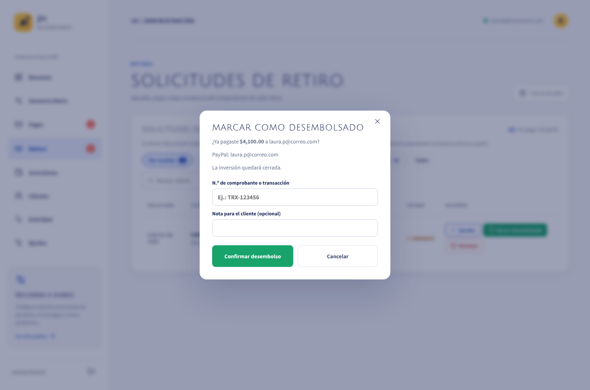

**Paso a paso para pagar un retiro:**

1. Copia los datos de *Dónde pagar*.
2. Haz el pago desde tu banco o billetera por el monto de *A pagar*.
3. Vuelve al panel → **Marcar desembolsado** → escribe el n.º de comprobante → **Confirmar desembolso**.
4. La inversión queda **cerrada**.

> ⚠️ Si una solicitud muestra **«Pago de prueba: no ingresó dinero»**, esa inversión se creó con el pago de prueba y **nunca entró dinero real**. No la pagues: recházala.

Las pestañas de arriba filtran por estado: *Por resolver*, *Pendientes*, *Aprobados*, *Desembolsados*, *Rechazados* y *Todos*.

---

## 9. Inversiones

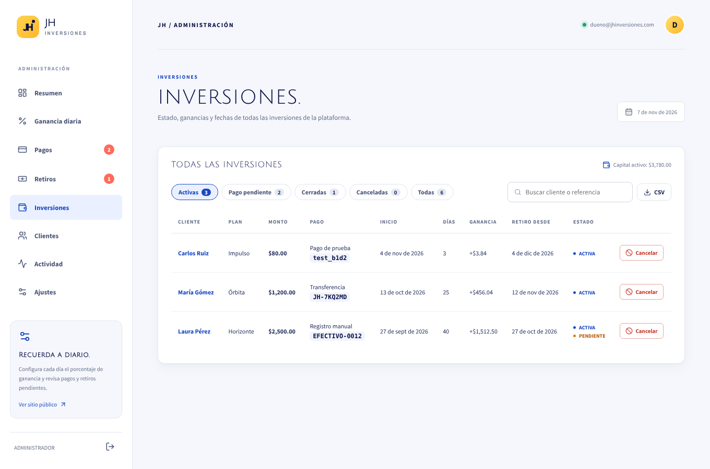

Todas las inversiones, con filtros por estado (*Activas*, *Pago pendiente*, *Cerradas*, *Canceladas*), búsqueda y exportación a CSV. Para cada una ves el plan, el monto, el método y la referencia de pago, los días transcurridos, la ganancia y la fecha desde la que se puede retirar.

**Cancelar una inversión:** solo para devoluciones o errores. Pide un motivo, deja la inversión **sin ganancias** y el cliente ya no podrá retirarla. Si tiene un retiro en curso, primero debes resolverlo en *Retiros*.

> Si el cliente simplemente quiere su dinero después del mes, no canceles: usa el flujo normal de **Retiros**.

---

## 10. Clientes

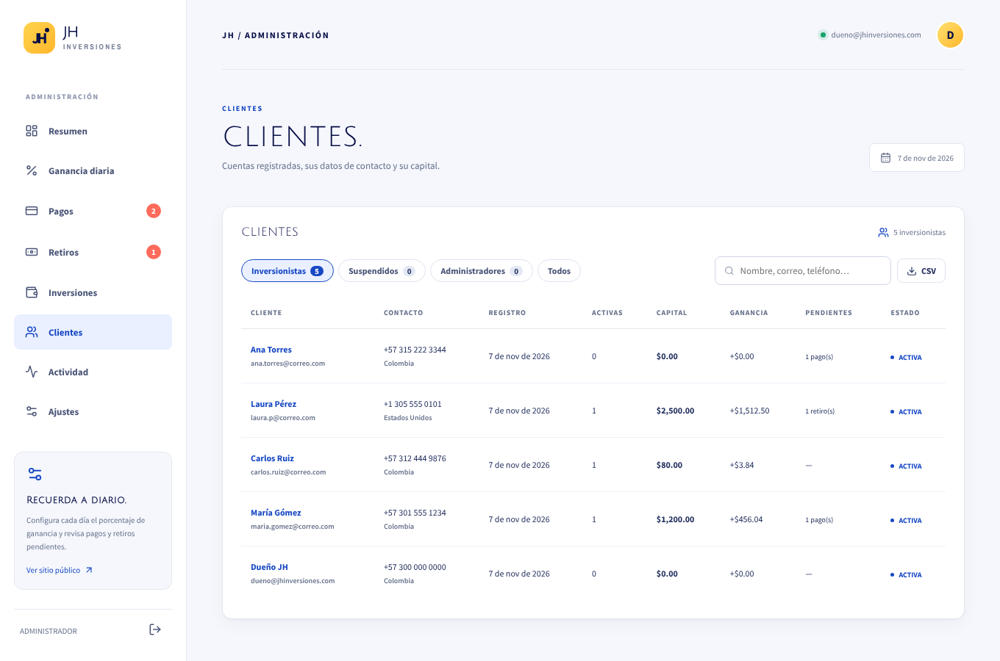

La lista de cuentas con su contacto, fecha de registro, capital activo, ganancia y lo que tienen pendiente. Las pestañas filtran por *Inversionistas*, *Suspendidos* y *Administradores*. Pulsa el nombre para abrir la **ficha del cliente**:

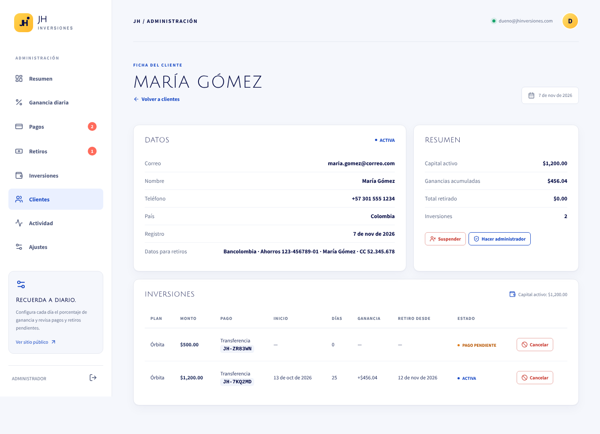

La ficha muestra sus **datos** (incluidos los datos para retiros), un **resumen** de su dinero y todas sus inversiones. Acciones disponibles:

- **Suspender:** puede entrar y ver su panel, pero **no puede invertir ni pedir retiros**. Se usa ante sospechas de fraude o problemas con la cuenta. Con **Reactivar** se revierte.
- **Hacer administrador / Quitar administrador:** da o quita acceso completo a este panel. Las cuentas que están en `ADMIN_EMAILS` siempre son administradoras.

No puedes suspenderte ni quitarte el rol a ti mismo.

---

## 11. Actividad

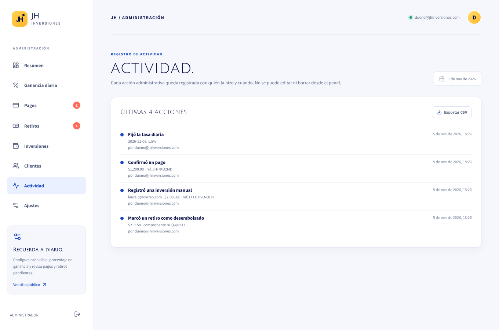

Un registro de **todas las acciones administrativas**: quién las hizo, cuándo y con qué datos (tasas fijadas, pagos confirmados o rechazados, inversiones manuales o canceladas, retiros aprobados, pagados o rechazados, cuentas suspendidas, cambios de rol y de ajustes). **No se puede editar ni borrar desde el panel**, así que sirve como auditoría. Se exporta en CSV.

---

## 12. Ajustes y exportaciones

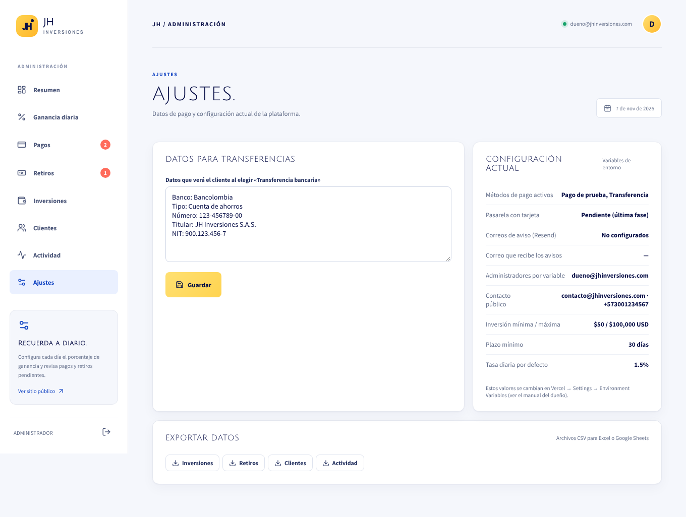

- **Datos para transferencias:** el texto que ve el cliente al elegir *Transferencia bancaria* (banco, tipo y número de cuenta, titular, NIT…). Puedes cambiarlo cuando quieras.
- **Configuración actual:** muestra, solo para consulta, los métodos de pago activos, el estado de la pasarela, si los correos de aviso están activos, los administradores y las reglas de inversión. Estos valores se cambian en las variables de entorno de Vercel (§2.2).
- **Exportar datos:** descarga CSV de inversiones, retiros, clientes y actividad. Se abren con Excel o Google Sheets.

---

## 13. Lo que ve el cliente

Conocer su recorrido te ayuda a darle soporte.

**Panel del cliente:** su capital, ganancias, la ganancia de hoy, un gráfico de 30 días, el avance del plazo mínimo, sus pagos pendientes (con tus datos bancarios y su referencia), sus solicitudes de retiro y todas sus inversiones.

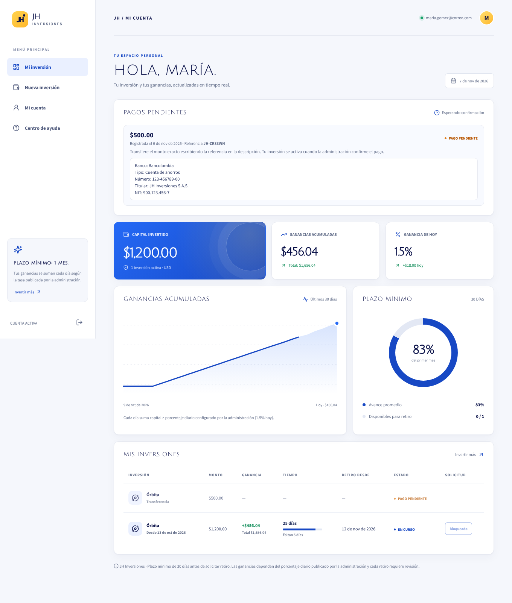

**Nueva inversión:** elige el monto, ve su plan, la ganancia de hoy y la fecha de retiro, el método de pago y acepta los términos.

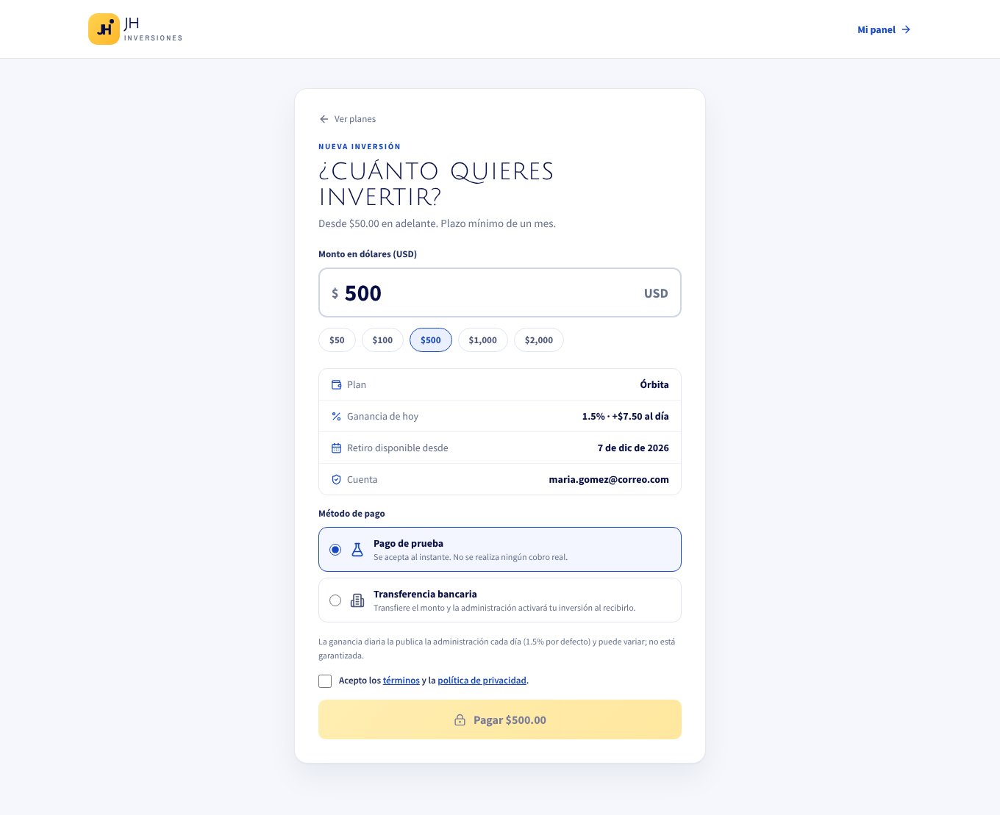

Si eligió **transferencia**, ve tus datos bancarios y su **referencia** con un botón para copiarla:

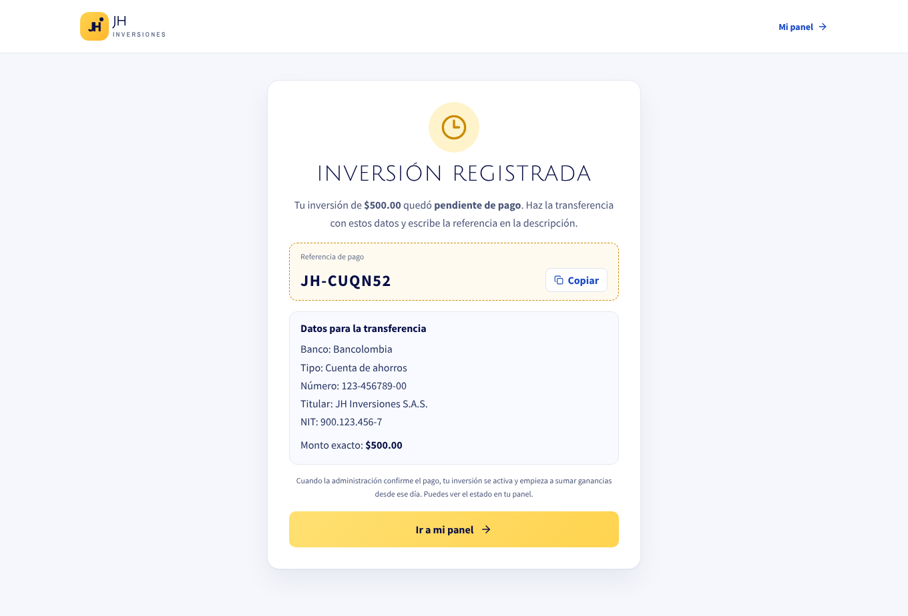

**Mi cuenta:** nombre, teléfono, país, **dónde recibir los retiros** y cambio de contraseña. Al pedir un retiro, sus datos de pago se rellenan solos desde aquí.

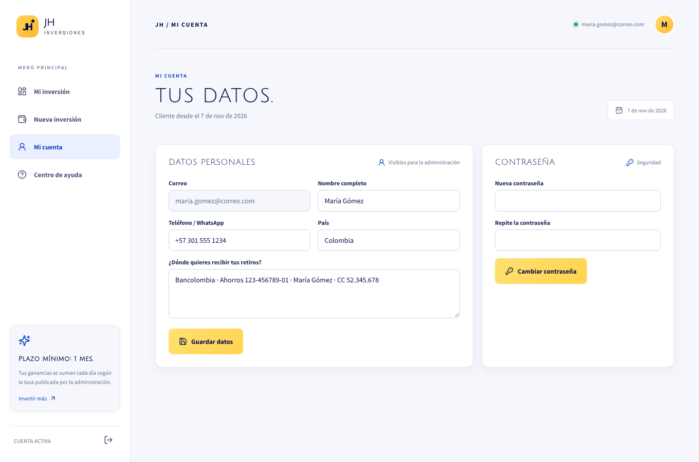

**Retiro solicitado:** el cliente ve el estado en todo momento.

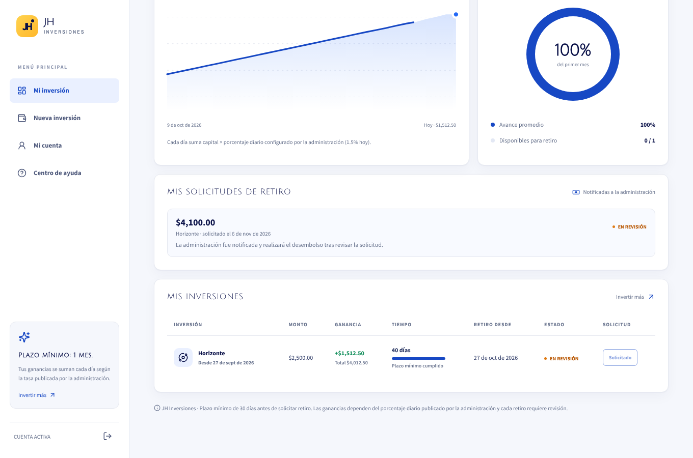

---

## 14. Cómo se calculan las ganancias

**Interés simple diario:** cada día la inversión gana *capital × porcentaje de ese día*. Las ganancias de un día **no** generan ganancias al día siguiente.

**Ejemplo** con 1,000 USD:

| Día | Tasa del día | Ganancia del día | Acumulado |
|---|---|---|---|
| 1 | 1.5 % (por defecto) | 15.00 | 15.00 |
| 2 | 2 % | 20.00 | 35.00 |
| 3 | 1 % | 10.00 | 45.00 |

- El día en curso suma de forma **proporcional** a las horas transcurridas (por eso el cliente ve su saldo subir en tiempo real).
- Los días se cuentan en **hora de Colombia (Bogotá)**.
- Las ganancias empiezan cuando el pago queda **confirmado** (no al registrar una transferencia).
- Al **solicitar el retiro**, las ganancias se **congelan** en ese momento. Si rechazas la solicitud, vuelven a sumar.
- Si corriges la tasa de un día pasado, todas las ganancias se recalculan con el nuevo valor.

---

## 15. Estados y su significado

**Inversión:**

| Estado | Significado |
|---|---|
| Pago pendiente | Registrada por transferencia; esperando que confirmes el pago. No gana nada. |
| Activa | Pago confirmado; gana cada día. |
| Cerrada | Retiro desembolsado. |
| Cancelada | Pago rechazado o inversión anulada por el administrador. No gana nada. |

**Retiro:**

| Estado | Significado |
|---|---|
| Pendiente / En revisión | El cliente lo solicitó; debes revisarlo. |
| Aprobado | Lo aprobaste; falta hacer el pago. |
| Desembolsado | Ya pagaste y registraste el comprobante. |
| Rechazado | No procede; el cliente ve el motivo y puede volver a pedirlo. |

**Cuenta:** *Activa* o *Suspendida*.

---

## 16. Correos automáticos

**Supabase** envía siempre los correos de cuenta: confirmación de registro y recuperación de contraseña.

Si configuras **Resend** (`RESEND_API_KEY`, `RESEND_FROM_EMAIL`, `ADMIN_NOTIFICATION_EMAIL`), la plataforma también envía estos:

| Evento | A quién |
|---|---|
| Un cliente registra una inversión por transferencia | A ti (`ADMIN_NOTIFICATION_EMAIL`) |
| Un cliente solicita un retiro (incluye sus datos de pago) | A ti |
| Confirmas o rechazas un pago | Al cliente |
| Registras una inversión manual | Al cliente |
| Apruebas, desembolsas o rechazas un retiro | Al cliente |

Sin Resend todo funciona igual: los avisos aparecen en el panel (números rojos y alertas).

---

## 17. Métodos de pago y la fase pendiente (pasarela)

| Método | Cómo funciona | Estado |
|---|---|---|
| **Pago de prueba** (`test`) | Se acepta al instante y muestra «Pago de prueba aceptado». **No cobra dinero.** | Listo (solo para pruebas) |
| **Transferencia bancaria** (`transfer`) | El cliente transfiere a tu cuenta y tú confirmas el pago en *Pagos* | **Listo para producción** |
| **Registro manual** | Tú registras un pago recibido por fuera | **Listo para producción** |
| **Pasarela con tarjeta** (`stripe`) | Cobro automático con tarjeta | **Fase pendiente** |

Los métodos que ve el cliente se eligen con `NEXT_PUBLIC_PAYMENT_METHODS`:

- Pruebas: `test,transfer`
- **Producción real: `transfer`.** Quita `test`: si lo dejas, cualquier persona podría crear inversiones sin pagar y, al mes, pedir un retiro.

**Fase pendiente: pasarela de pago.** Toda la parte de inversiones, ganancias, retiros y administración ya funciona. Lo único que falta es conectar una **pasarela que cobre con tarjeta automáticamente**. El código ya trae un ejemplo con Stripe y el lugar exacto donde se conecta. Los pasos técnicos están en [`docs/pasarela-de-pagos.md`](pasarela-de-pagos.md).

> Antes de conectarla, confirma por escrito que el proveedor acepta esta actividad (muchos no aceptan servicios de inversión sin revisión previa) y que cuentas con las autorizaciones financieras de tu país.

---

## 18. Preguntas frecuentes y solución de problemas

**Olvidé fijar la tasa de un día.**
Ese día se aplicó 1.5 %. Si quieres otro valor, ve a *Ganancia diaria* → historial → ✏️ en ese día. Las ganancias se recalculan.

**Un cliente transfirió un monto distinto al registrado.**
Rechaza la inversión pendiente (motivo: «monto distinto») y registra un **pago manual** por el monto que realmente llegó, con la referencia de la transferencia.

**Un cliente me pagó en efectivo.**
Pídele que se registre y usa *Pagos → Registrar un pago manual*.

**Un cliente dice que no le llega el correo de confirmación.**
Que revise el spam. Si usas el correo incluido de Supabase, el límite de envíos es muy bajo: configura SMTP propio (§2.1). Si el problema sigue, un desarrollador puede confirmar la cuenta manualmente desde Supabase (*Authentication → Users*).

**Un cliente olvidó su contraseña.**
Que use **¿Olvidaste tu contraseña?** en `/acceso`.

**Quiero agregar otro administrador.**
Que se registre como cliente; luego, en *Clientes → su ficha → Hacer administrador*. O agrega su correo a `ADMIN_EMAILS`.

**Un retiro está mal (datos bancarios incompletos).**
**Recházalo** con el motivo. El cliente corrige sus datos y lo vuelve a pedir.

**Pagué un retiro pero olvidé marcarlo.**
Márcalo como desembolsado cuando lo veas, con el comprobante. La fecha queda registrada en *Actividad*.

**Sospecho de una cuenta.**
**Suspéndela** desde su ficha: no podrá invertir ni retirar mientras revisas.

**La página dice «Falta configurar Supabase».**
Faltan `NEXT_PUBLIC_SUPABASE_URL` o `NEXT_PUBLIC_SUPABASE_ANON_KEY` en Vercel. Agrégalas y vuelve a desplegar.

**El panel de administración muestra un error al cargar.**
Normalmente falta o es incorrecta la `SUPABASE_SERVICE_ROLE_KEY`, o no se ejecutó la versión más reciente de `supabase/schema.sql`.

---

## 19. Seguridad y buenas prácticas

- La **`SUPABASE_SERVICE_ROLE_KEY` es secreta**: da acceso total a la base de datos. Solo va en Vercel, nunca en el código ni en mensajes.
- Cada cliente **solo puede ver sus propios datos**. Ningún cliente puede crear inversiones, cambiar tasas ni darse permisos (está probado automáticamente).
- Todo lo que hace un administrador queda en **Actividad**.
- Marca **desembolsado** solo después de pagar, y siempre con el comprobante.
- Activa los **respaldos** de Supabase (*Database → Backups*) según tu plan.
- Usa una contraseña fuerte y no compartas tu cuenta de administrador: crea una cuenta para cada persona.
- Revisa con un **abogado** los términos (`/terminos`) y la política de privacidad (`/privacidad`) antes de recibir dinero.

---

## 20. Pruebas automáticas

La plataforma incluye pruebas que verifican que todo funciona. Las ejecuta un desarrollador con `pnpm test` y `pnpm test:e2e` (ver README).

- **20 pruebas de cálculo:** ganancias diarias, tasa por defecto, zona horaria, plazo mínimo, congelamiento al retirar, estados sin ganancia, planes y validaciones.
- **27 pruebas de punta a punta** sobre una base de datos real:
  - **Cuentas:** registro con confirmación por correo, contraseña incorrecta, recuperación de contraseña, Mi cuenta.
  - **Ciclo completo:** aviso diario y tasa, datos de transferencia, pago de prueba, transferencia confirmada y rechazada, plazo mínimo, retiro rechazado y vuelto a pedir, aprobado y desembolsado con comprobante, registro de actividad y CSV.
  - **Administración:** pago manual, referencias duplicadas, fichas de clientes, suspensión y reactivación, cancelación, roles.
  - **Seguridad:** páginas privadas, permisos de cada API, validación de montos, bloqueo de solicitudes desde otros sitios y aislamiento de datos entre clientes.
